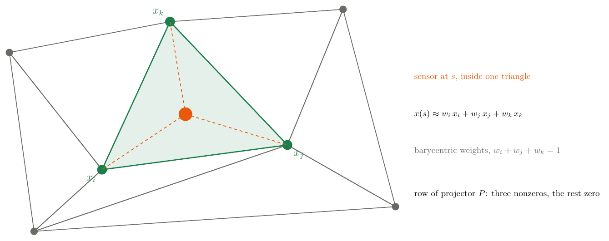
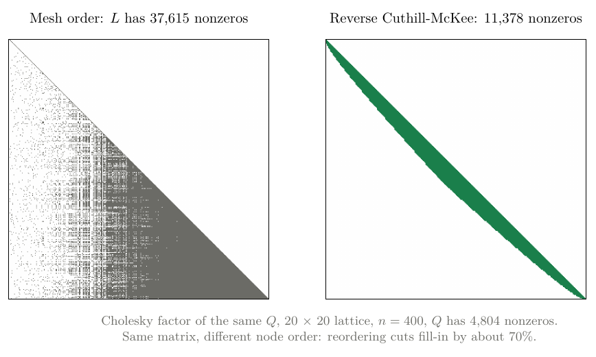

# android-opencv-lanedetection: SPDE-GMRF Estimation and On-Device Forward Filtering

[](https://github.com/whatheheckisthis/android-opencv-lanedetection-master/actions/workflows/ci.yml)
[](https://whatheheckisthis.github.io/case-studies/spde-gmrf-gpu-edge/)


On-device lane detection for Android with OpenCV, revived as the perception front end for the case study Lifting SPDE-GMRF Fields: GPU Estimation and On-Device Forward Filtering. This repository implements the pipeline that study describes: a sparse SPDE precision estimated on a GPU, a sparse projector from mesh nodes to sensors, and an int8 forward filter for Arm Cortex-M. It is a system design with a tested reference implementation. It is not a benchmark: no GPU timing, device latency or recorded-drive accuracy has been measured.

The key words MUST, MUST NOT, SHALL, SHOULD and MAY in this document are to be interpreted as described in BCP 14 (RFC 2119 and RFC 8174).

## Contents

- [Scope](#scope)
- [Lineage](#lineage)
- [Motivation](#motivation)
- [Objectives](#objectives)
- [Assumptions](#assumptions)
- [Method](#method)
- [Evidence](#evidence)
- [Requirements](#requirements)
- [Build and Test](#build-and-test)
- [Repository Layout](#repository-layout)
- [Security](#security)
- [Attribution](#attribution)
- [Licence](#licence)

## Scope

In scope:

- FEM mesh assembly, the SPDE precision Q(theta) and its sparse Cholesky factorisation, with a CPU reference and a CUDA path (cuSPARSE and cuDSS).
- The sparse projector P, with three barycentric weights per sensor.
- The ordering and fill-in result, reverse Cuthill-McKee against a scrambled node order.
- The int8 forward filter for Cortex-M, with a CMSIS-NN backend and a portable C99 reference, checked against a floating-point filter.

Out of scope:

- GPU timings, device latency on Cortex-M, and accuracy on recorded drives.
- Fitting the transition and emission parameters to recorded data.

Known limitations:

- The CUDA code in `gpu/` has not been compiled or run. It MUST be built and checked against `gpu/compare.py` before any GPU result is reported.
- The CMSIS-NN backend has been checked against stub headers only. It MUST be built against the pinned CMSIS-NN release before use on a target.
- All test data are simulated with fixed seeds.

## Lineage

| Period            | Status                                                                                              |
|-------------------|------------------------------------------------------------------------------------------------------|
| 2014              | Original application developed by Wahib-ul-Haq as an MSc Computer Science semester project at TUM   |
| Summer 2019       | Derived into an advanced driver assistance systems (ADAS) venture                                   |
| October 2024      | ADAS venture incorporated                                                                            |
| April 2025        | Venture disbanded; codebase refactored                                                               |
| 17 November 2026  | Revived, following tacit approval, as part of the SPDE-GMRF study                                    |

## Motivation

A dashboard-mounted phone can detect lane markings and estimate the Standard Deviation of Lane Position (SDLP), a common measure of lateral control. Lane position alone does not explain why control changes. A driver moves between a small number of behavioural modes (calm, alert, high stress and panic) and drifts gradually within each mode. The model separates the two: a hidden Markov model for the modes and a sparse Gaussian field (SPDE-GMRF) for the drift.

## Objectives

1. Estimate the field and its parameters on a GPU, where large sparse factorisations belong.
2. Lift the field estimate to sensor locations with a sparse projector.
3. Decide the current mode on the device with one small int8 recursion per sample.
4. Check the int8 recursion against a floating-point reference before any latency claim is made.

## Assumptions

- Observations are a lateral lane offset and an SDLP window, both in millimetres.
- The field enters the lateral offset channel only, through the lifted offset of the current site.
- Transition and emission parameters are illustrative and have not been fitted to recorded data.
- All data used by the tests are simulated with fixed seeds.

## Method

The model has a heavy part and a light part. Estimating the spatial field and its parameters means factorising large sparse precision matrices, which belongs on a GPU. Deciding the current behavioural mode means one small recursion per sample, which belongs on the device.


Figure 1. Heavy path and light path. The mesh matrices C and G are assembled once. The GPU rebuilds Q(theta), factorises it and returns theta_hat and the field estimate x_hat. Those are lifted to the sensor locations and quantised for the device, which runs the forward filter on every sample. Re-estimation runs periodically, off the latency path.

```
 FEM mesh: C (lumped), G             assembled once
        |
        v
 +--------------------------------+   Q(theta) = tau^2 (kappa^4 C + 2 kappa^2 G + G C^-1 G)
 | Estimation (GPU; CPU reference)|   fixed pattern, symbolic analysis once,
 | sparse Cholesky, log|Q| =      |   numeric refactorisation per theta
 | 2 sum log L_ii, (kappa, tau)   |
 +---------------+----------------+
                 |  x_hat
                 v
 +--------------------------------+   each row of P: three barycentric weights,
 | Lift: offsets = P x_hat        |   summing to one
 +---------------+----------------+
                 |  int8 A^T, offsets, emission constants
                 v
 +--------------------------------+   alpha_t(k) ~ b_k(y_t) sum_j a_jk alpha_{t-1}(j)
 | Forward filter (Cortex-M)      |   A^T alpha as arm_fully_connected_s8;
 | argmax = current mode          |   fixed-point rescale prevents underflow
 +--------------------------------+
        ^                                    |
        +---- periodic re-estimation --------+  (off the latency path)
```

### Lifting the field to the sensors

The field lives on mesh nodes, but the signals arrive at sensor locations. Lifting maps one to the other with a sparse projector P, so the observation model becomes y = mu_S + H P x + e. Because the finite elements are piecewise linear, each sensor reads from the three corners of the triangle it falls in, and each row of P has three nonzeros.



Figure 2. One sensor, three weights. The field at sensor s is w_i x_i + w_j x_j + w_k x_k, with barycentric weights that sum to one. The posterior precision Q + P^T H^T D_S H P therefore stays sparse: lifting adds only local couplings between nodes that share a sensor.

### Parameter estimation on the GPU

Every evaluation of the likelihood for a candidate theta = (kappa, tau) rebuilds Q(theta) from the fixed C and G, factorises it, and reads the log-determinant from the diagonal of the factor. The sparsity pattern does not change, only the values, so the symbolic analysis is performed once and reused. cuSPARSE handles the sparse assembly and the sparse matrix-vector products. The case study names cuSOLVER for the factorisation and notes that its sparse module is deprecated; this repository uses cuDSS, as the study recommends for a new build, and keeps the rest of the design unchanged.



Figure 3. Ordering decides the cost, as published in the case study. On a 20 by 20 lattice, n = 400, Q has 4,804 nonzeros. The study reports 37,615 factor nonzeros for a scrambled node order and 11,378 after reverse Cuthill-McKee, about 70% fewer. This repository reproduces 4,804 and 11,378 exactly; its scrambled counts differ and are given under [Evidence](#evidence). The figure regenerated from this repository is `docs/spde-fill-in.png`.

### Forward filtering on the device

Once the field is estimated, the device does not need it in full. It needs the lifted offsets P x_hat for its own sensors and the transition matrix A. With four regimes, the forward step is alpha_t(k) proportional to b_k(y_t) sum_j a_jk alpha_(t-1)(j): one 4 by 4 matrix-vector product, four multiplies and a normalisation per sample.


Figure 4. The per-sample recursion. The product A^T alpha_(t-1) has the same shape as a fully connected layer, so it runs on the int8 fully connected kernel in CMSIS-NN. The emission term uses the lifted offsets, and a fixed-point rescale keeps the belief normalised so that it does not underflow. The largest entry of alpha_t is the current behavioural mode, evaluated locally with no round trip to the GPU.

The prediction step uses the CMSIS-NN kernel when `HMM_USE_CMSIS_NN` is defined. Otherwise a portable C99 kernel with the same integer semantics is used, which is how the host tests run. The four regimes keep a direct calm-to-panic transition, which survives quantisation.

### Why the split works

The expensive work, factorising a large sparse precision, depends only on how fast the environment changes, so it can run every few seconds or minutes. The cheap work depends on every sample, and its cost is fixed by the number of regimes, not by the size of the field.

## Evidence

The following figures are produced by the tests on simulated data.

| Quantity                                                   | Result                                     |
|------------------------------------------------------------|--------------------------------------------|
| 20 by 20 lattice, n = 400, nonzeros of Q                    | 4,804                                      |
| Cholesky factor nonzeros after reverse Cuthill-McKee        | 11,378                                     |
| Cholesky factor nonzeros, scrambled order (seeds 0, 1, 2)  | 45,258; 44,510; 43,640                     |
| Reduction from reordering                                  | 74.9%, 74.4%, 73.9%                        |
| Rows of P with exactly three weights summing to one         | all rows                                   |
| Estimated kappa and tau, relative error (16 by 16 mesh)     | 3.0% and 2.9%                              |
| int8 against float, mode agreement (5,000 samples)          | 99.66%                                     |
| int8 against float, mean absolute belief error             | 0.0020                                     |
| C kernel against Python integer mirror                      | bit-exact                                  |

The case study reports 37,615 factor nonzeros for its scrambled order. That count depends on the random relabelling and is not reproduced here; the RCM count of 11,378 is reproduced exactly. The figure can be regenerated with `python python/tools/fill_in_figure.py docs/spde-fill-in.png`.

Not yet measured: GPU timings, device latency on Cortex-M, and accuracy on recorded drives. No latency claim SHALL be made until these are measured.

## Requirements

- Python 3.11 with the packages in `python/requirements.txt`.
- A C99 compiler and make for the firmware host tests. CI uses gcc on Ubuntu.
- For the GPU path only: CUDA, cuSPARSE, cuDSS and CMake. These are not required for the tests.
- For a Cortex-M build only: the CMSIS-NN release the build pins, with `HMM_USE_CMSIS_NN` defined.

## Build and Test

```
pip install -r python/requirements.txt
python -m pytest -s                  # Python reference and C kernel cross-check
make -C firmware test                # host build of the forward filter
python -m spdegmrf.export            # from python/: regenerate firmware headers
```

On a machine with CUDA and cuDSS:

```
cmake -S gpu -B gpu/build && cmake --build gpu/build
(cd python && python -m spdegmrf.export --gpu-case ../case.bin)
./gpu/build/spde_gpu case.bin > gpu.csv && python gpu/compare.py gpu.csv
```

Continuous integration runs the Python tests and the firmware host tests on Ubuntu. The GPU build is excluded because hosted runners have no GPU.

## Repository Layout

```
python/spdegmrf/   mesh, FEM assembly, SPDE precision, sparse Cholesky, projector,
                   estimation, lattice fill-in, float HMM filter, int8 quantisation, export
python/tests/      unit tests for every module above
python/tools/      fill-in figure script
gpu/               CUDA estimation with cuSPARSE and cuDSS, CMake, CPU comparison script
firmware/          C99 forward filter, portable int8 kernel, CMSIS-NN backend, host tests
docs/              regenerated fill-in figure; docs/figures/ holds the case study figures
.github/workflows/ continuous integration
```

The Android project files at the repository root are retained from the original application.

## Security

Commits SHALL be signed with the maintainer key in [KEYS.asc](KEYS.asc). Verification steps and vulnerability reporting are in [SECURITY.md](SECURITY.md).

## Attribution

- Original application and project report, *Computer Vision on Nomadic Devices for Human Factors Engineering*, by Wahib-ul-Haq (TUM): [project report](https://www.academia.edu/11329425/Computer_vision_on_nomadic_devices_for_human_factors_engineering).
- Core lane detection based on [lane-detection](https://github.com/jdorweiler/lane-detection) by J. Dorweiler, described in [Revisiting lane detection using OpenCV](http://www.transistor.io/revisiting-lane-detection-using-opencv.html), ported to the Android NDK and optimised for smartphones in the original application.
- Related case study: [Lifting SPDE-GMRF Fields: GPU Estimation and On-Device Forward Filtering](https://whatheheckisthis.github.io/case-studies/spde-gmrf-gpu-edge/).
- Previous case study: [Hidden Markov models with Gaussian fields](https://whatheheckisthis.github.io/case-studies/hmm-gaussian-fields/).
- Lindgren, Rue and Lindstrom, [An explicit link between Gaussian fields and Gaussian Markov random fields: the SPDE approach](https://doi.org/10.1111/j.1467-9868.2011.00777.x).
- NVIDIA [cuSPARSE](https://docs.nvidia.com/cuda/cusparse/), [cuDSS](https://docs.nvidia.com/cuda/cudss/) and [cuSOLVER](https://docs.nvidia.com/cuda/cusolver/) documentation; Arm [CMSIS-NN](https://github.com/ARM-software/CMSIS-NN).

## Licence

MIT. The original copyright notice (Copyright (c) 2014 wahib-ul-haq) is retained in [LICENSE](LICENSE).
