# android-opencv-lanedetection: SPDE-GMRF Estimation and On-Device Forward Filtering

[](https://docs.nvidia.com/cuda/)
[](https://docs.nvidia.com/cuda/cusparse/)
[](https://docs.nvidia.com/cuda/cudss/)
[](https://docs.nvidia.com/cuda/cusolver/)
[](https://developer.arm.com/Processors/Cortex-M4)
[](https://github.com/ARM-software/CMSIS-NN)

On-device lane detection for Android with OpenCV, revived as the perception front end for the case study Lifting SPDE-GMRF Fields: GPU Estimation and On-Device Forward Filtering. This repository implements the pipeline that study describes: a sparse SPDE precision estimated on a GPU, a sparse projector from mesh nodes to sensors, and an int8 forward filter for Arm Cortex-M. It is a system design with a tested reference implementation. It is not a benchmark: no GPU timing, device latency or recorded-drive accuracy has been measured.

The key words MUST, MUST NOT, SHALL, SHOULD and MAY in this document are to be interpreted as described in BCP 14 (RFC 2119 and RFC 8174).

## Contents

- [Key features](#key-features)
  - [1. SPDE-GMRF and HMM model (Python reference)](#1-spde-gmrf-and-hmm-model-python-reference)
  - [2. GPU parameter estimation (host)](#2-gpu-parameter-estimation-host)
  - [3. On-device forward filtering (CMSIS-NN firmware)](#3-on-device-forward-filtering-cmsis-nn-firmware)
  - [4. CARLA simulation loop and the Android application](#4-carla-simulation-loop-and-the-android-application)
- [Scope](#scope)
- [Architecture](#architecture)
- [Repository layout](#repository-layout)
- [Requirements](#requirements)
- [Build and Test](#build-and-test)
- [Figures](#figures)
- [Security](#security)
- [Attribution](#attribution)
- [Licence](#licence)

## Key features

The repository has four parts. Each part names the code that runs and the check that covers it. Figures 5 to 16 are produced from these sources by [`.github/workflows/captures.yml`](.github/workflows/captures.yml); see [Figures](#figures).

| # | Feature | What runs | Checked by |
|---|---|---|---|
| 1 | [SPDE-GMRF and HMM model (Python reference)](#1-spde-gmrf-and-hmm-model-python-reference) | `python/spdegmrf`: mesh, FEM assembly, Q(theta), sparse Cholesky, projector, estimation of (kappa, tau), float and int8 forward filters, under Python 3.11 | 20 pytest tests (Figure 5); `python/tools/mac_table.py` (Figure 6); plots from the same code (Figures 7 to 11) |
| 2 | [GPU parameter estimation (host)](#2-gpu-parameter-estimation-host) | `gpu/src/spde_gpu.cu` with cuSPARSE and cuDSS | `gpu/compare.py` against the CPU reference on a GPU host (not run: no GPU in CI); nvcc 12.9 compile only (Figure 12); `test_gpu_case.py` checks the case file |
| 3 | [On-device forward filtering (CMSIS-NN firmware)](#3-on-device-forward-filtering-cmsis-nn-firmware) | `firmware/`: C99 int8 filter, portable kernel and CMSIS-NN backend | `make -C firmware test` with gcc (Figure 13); `arm-none-eabi-gcc` Cortex-M4F footprint (Figure 14); firmware tests under `qemu-arm` with both kernels (Figure 15); bit-exact pytest check of the C kernel |
| 4 | [CARLA simulation loop and the Android application](#4-carla-simulation-loop-and-the-android-application) | Android OpenCV lane detector at the repository root; CARLA clips in `assets/videos/` as sample input | Not checked in CI: the closed loop is a design, and the Android build needs the Android SDK and NDK. The clips are read by ffmpeg (Figure 16) |

### 1. SPDE-GMRF and HMM model (Python reference)

#### The Two-Layer Model

This section follows case study 03, [Hidden Markov Models with Gaussian Fields for Behavioural Time Series](https://whatheheckisthis.github.io/case-studies/hmm-gaussian-fields/), which defines the model that this repository estimates and filters.

Human behaviour does two things at once: it jumps between qualitative modes, and it drifts slowly inside them. A hidden Markov model captures the jumps. A Gaussian Markov random field captures the drift. Joined together, and kept sparse through the SPDE approach, the model remains small enough to filter in real time.

| Layer | Representation |
|---|---|
| Discrete | HMM over calm, alert, high stress and panic, K = 4 |
| Continuous | Gaussian field with sparse precision Q(theta) |
| Scaling | SPDE link from Matern fields to GMRFs |

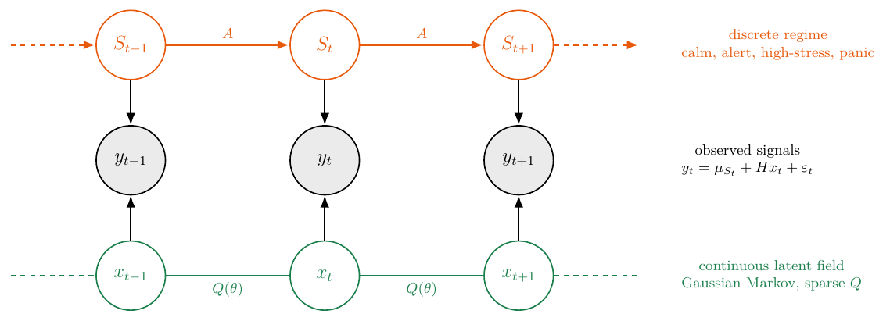

Case study 03, Figure 1. Two latent layers, one observation. The regime chain S_t moves through the transition matrix A. The field x_t is a Gaussian Markov structure with precision Q(theta). Each observation depends on both: y_t = mu_S + H x_t + e_t, with noise e_t ~ N(0, Sigma_S) set by the current regime.

#### Why a plain HMM is not enough

A standard HMM assumes that, given the regime, observations are independent draws from a fixed distribution. Behavioural signals break that assumption. Fatigue builds over a drive, environmental pressure rises and falls, and nearby sensors move together. Forcing that slow variation into discrete states either needs far more states than the problem has meaning for, or it appears as spurious regime switches. Neither helps an interface decide when to escalate. A second, continuous latent layer resolves this: the regimes stay few and interpretable, and the field absorbs the gradual drift, the spatial proximity and the non-stationary noise around them.

#### The HMM backbone

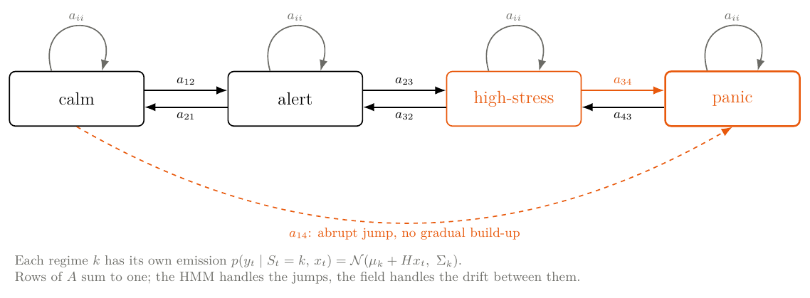

Case study 03, Figure 2. Regimes and transitions. Each regime has its own emission N(mu_k + H x_t, Sigma_k). Most mass sits on self-transitions and neighbours, but the model keeps a direct path such as a_14 from calm to panic, because the moments that matter most are the ones with no gradual build-up. The int8 model in this repository MUST retain a nonzero a_14 after quantisation; the tests check this.

#### Keeping the field sparse with SPDE

A Gaussian field with a Matern covariance is the natural choice for smooth variation, but its covariance matrix is dense, and every likelihood evaluation would cost a dense factorisation. The SPDE approach of Lindgren, Rue and Lindstrom replaces it. A Matern field is the solution of (kappa^2 - Laplacian)^(alpha/2) (tau x) = W, driven by white noise W. Solving that equation with finite elements gives a Gaussian Markov random field whose precision is sparse. For alpha = 2, Q = tau^2 (kappa^4 C + 2 kappa^2 G + G C^-1 G), where C is the lumped mass matrix and G the stiffness matrix.

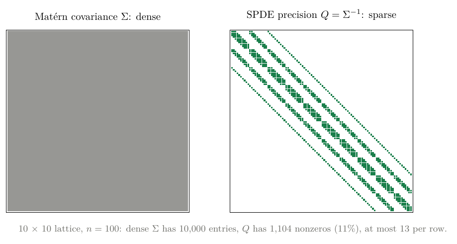

Case study 03, Figure 3. Dense covariance against sparse precision. Computed on a 10 by 10 lattice with n = 100. The covariance has 10,000 entries. The precision has 1,104 nonzeros, at most 13 per row, and that count per row stays fixed as the mesh grows. The parameter kappa sets the range, about sqrt(8 nu)/kappa with nu = alpha - d/2, and tau sets the variance. This repository reproduces the 1,104 count.

#### Joint inference

Exact inference in a switching model is out of reach: the posterior over the field is a mixture of K^T Gaussians, one for every regime path. The model is split instead. Given the field, the regimes are an ordinary HMM, and forward filtering with backward sampling costs O(T K^2). Given the regimes, the field is Gaussian with precision Q + H^T D_S H, which is still sparse, so one sparse Cholesky factorisation gives its mean and a sample.

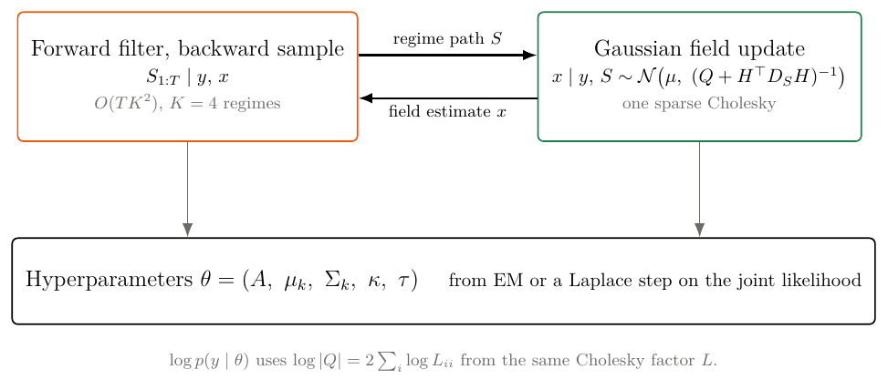

Case study 03, Figure 4. The inference loop. The two steps alternate, and the hyperparameters theta = (A, mu_k, Sigma_k, kappa, tau) are updated from the joint likelihood by EM or a Laplace step. The same Cholesky factor L that solves for the field gives log|Q| = 2 sum log L_ii, so the likelihood costs no extra factorisation.

This repository implements the field side of the loop (estimation of kappa and tau with log|Q| read from the factor) and the forward filter. Backward sampling and the EM or Laplace update of A, mu_k and Sigma_k are not implemented; the regime parameters are fixed and illustrative.

#### What the model provides

Few, meaningful regimes that map directly onto interface states and escalation logic. A continuous layer that explains slow drift instead of mislabelling it as a regime change. A cost per step that grows with the number of nonzeros in Q, not with the square of the field size.

#### Lifting the field to the sensors

The field lives on mesh nodes, but the signals arrive at sensor locations. Lifting maps one to the other with a sparse projector P, so the observation model becomes y = mu_S + H P x + e. Because the finite elements are piecewise linear, each sensor reads from the three corners of the triangle it falls in, and each row of P has three nonzeros.


Figure 2. One sensor, three weights. The field at sensor s is w_i x_i + w_j x_j + w_k x_k, with barycentric weights that sum to one. The posterior precision Q + P^T H^T D_S H P therefore stays sparse: lifting adds only local couplings between nodes that share a sensor.

#### The lifting step

Once the GPU has estimated theta_hat and factorised the field, the high-dimensional SPDE-GMRF model is distilled into a compact, discrete-time representation that a device can run. In this repository, and in the case study, that representation is the sparse projector P applied to x_hat: each sensor receives an offset P x_hat formed from three barycentric weights, and the device runs the four-regime HMM using those offsets. A reduced-rank Kalman filter over the field, or a learned neural surrogate, are alternative compact forms. Neither is implemented here.

Figure 7 shows the field estimated by this code on the 16 by 16 mesh, Figure 8 the likelihood surface that the estimate maximises, Figures 9 and 10 the sparsity and fill-in results, and Figure 11 the float and int8 forward filters on the test data.

### 2. GPU parameter estimation (host)

#### Parameter estimation on the GPU

Every evaluation of the likelihood for a candidate theta = (kappa, tau) rebuilds Q(theta) from the fixed C and G, factorises it, and reads the log-determinant from the diagonal of the factor. The sparsity pattern does not change, only the values, so the symbolic analysis is performed once and reused. cuSPARSE handles the sparse assembly and the sparse matrix-vector products. The case study names cuSOLVER for the factorisation and notes that its sparse module is deprecated; this repository uses cuDSS, as the study recommends for a new build, and keeps the rest of the design unchanged.


Figure 3. Ordering decides the cost, as published in the case study. On a 20 by 20 lattice, n = 400, Q has 4,804 nonzeros. The study reports 37,615 factor nonzeros for a scrambled node order and 11,378 after reverse Cuthill-McKee, about 70% fewer. This repository reproduces 4,804 and 11,378 exactly. The scrambled count depends on the random relabelling; 37,615 lies within the range of 1,000 relabellings (Figure 10). The figure regenerated from this repository is `docs/spde-fill-in.png`.

#### Host side: NVIDIA CUDA libraries

This section sets out the role of each NVIDIA and Arm library in the design and states which parts this repository uses. Roles marked as not used describe where a library would fit; they are not implemented here.

| Library | Role in the design | In this repository |
|---|---|---|
| cuSPARSE | Matrix construction and sparse products. Holds the sparse precision Q in CSR form and performs the sparse matrix-vector and matrix-matrix products used during iterative optimisation. | Used: `cusparseCreateCsr` for Q and `cusparseSpMM` for sparse products in `gpu/src/spde_gpu.cu`. |
| cuDSS | Direct sparse solver. Estimating the GMRF requires log\|Q\|, which comes from the sparse Cholesky factorisation Q = L L^T as 2 sum log L_ii. cuDSS performs that exact factorisation on the GPU. Because the pattern of Q is fixed, the analysis phase runs once and only the numeric refactorisation repeats for each candidate theta. | Used: SPD matrix type, `CUDSS_PHASE_ANALYSIS` once, then `CUDSS_PHASE_REFACTORIZATION` and `CUDSS_PHASE_SOLVE`, with `CUDSS_DATA_DIAG` for the factor diagonal. |
| cuSOLVER | Dense sub-problems: dense covariance blocks, eigenvalue decompositions for spectral approximations, and small dense systems arising when optimising the low-dimensional hyperparameter vector theta. The case study names its sparse Cholesky module for the factorisation; NVIDIA marks that module as deprecated, so a new build SHOULD use cuDSS for the sparse factorisation. | Not used. theta = (kappa, tau) has two components and is optimised on the host. |

Fill-in is controlled by ordering, not by the solver alone. The factorisation SHOULD use a fill-reducing ordering (reverse Cuthill-McKee, AMD or METIS nested dissection); Figure 3 and the Evidence section show the effect on a 20 by 20 lattice.

#### Operation counts

The table below measures the work in each stage as multiply-accumulate operations (MACs), and each row names the matrix it is derived from. Host counts are computed from the sparsity pattern of that matrix by `python/tools/mac_table.py`, on the 16 by 16 estimation mesh (n = 256, 200 sensors, 64 device sites) and on the 20 by 20 lattice of Figure 3. For a factor whose column j has eta_j entries below the diagonal, the factorisation costs sum_j eta_j (eta_j + 1) / 2 MACs, the two triangular solves cost 2 (nnz(L) - n), and a sparse product M x costs nnz(M). The tests in `python/tests/test_mac_table.py` check that each row agrees with its matrix.

#### Host: per evaluation of theta

| Stage | Matrix | n | nnz | MACs | Per |
|---|---|---|---|---|---|
| Assemble Q(theta) values | Q (16x16 mesh) | 256 | 3,012 | 9,036 | theta (multiplies) |
| Sparse product Q x | Q (16x16 mesh) | 256 | 3,012 | 3,012 | product |
| Cholesky of Q | L of Q, RCM | 256 | 5,896 | 72,538 | theta |
| Cholesky of Q + P^T P / sigma^2 | L of posterior precision, RCM | 256 | 5,896 | 72,538 | theta |
| Posterior mean solve | L of posterior precision | 256 | 5,896 | 11,280 | right-hand side |
| Sensor product P^T y | P (200 sensors) | 200 | 600 | 600 | right-hand side |
| Lift x_hat to device sites | P_dev (64 sites) | 64 | 192 | 192 | re-estimation |
| Cholesky, 20x20 lattice, RCM | L of Q (Figure 3) | 400 | 11,378 | 174,362 | theta |
| Cholesky, 20x20 lattice, scrambled (seed 0) | L of Q (Figure 3) | 400 | 45,258 | 3,877,939 | theta |

The same 20 by 20 matrix costs 174,362 MACs to factorise after reverse Cuthill-McKee and 3,877,939 in the scrambled order, a factor of about 22. This is the cost that Figure 3 shows as fill-in, and it is the reason the factorisation SHOULD be reordered. On the estimation mesh, adding P^T P / sigma^2 to Q adds no nonzeros to the factor (5,896 in both), because each sensor couples only the three nodes of its triangle.

The captures workflow reran `python/tools/mac_table.py` on Python 3.11.18 with NumPy 2.4.6 and SciPy 1.17.1; every host and device row in its output matches the tables in this README (Figure 6).

Status recorded by the captures workflow: `gpu/src/spde_gpu.cu` compiles with nvcc 12.9 (`-std=c++17 -O2 -arch=sm_80 -c`) against the cuDSS 0.7.1.6 headers. It does not compile against cuDSS 1.0.0.35, whose `cudssMatrixCreateCsr` takes an additional `offsetType` argument (eight errors, at lines 179 and 181). It was compiled only; it was not linked and not run, and no GPU result exists (Figure 12). The statements in [Scope](#scope) and in the technology table that the CUDA code has not been compiled are retained as written before this capture.

### 3. On-device forward filtering (CMSIS-NN firmware)

#### Forward filtering on the device

Once the field is estimated, the device does not need it in full. It needs the lifted offsets P x_hat for its own sensors and the transition matrix A. With four regimes, the forward step is alpha_t(k) proportional to b_k(y_t) sum_j a_jk alpha_(t-1)(j): one 4 by 4 matrix-vector product, four multiplies and a normalisation per sample.

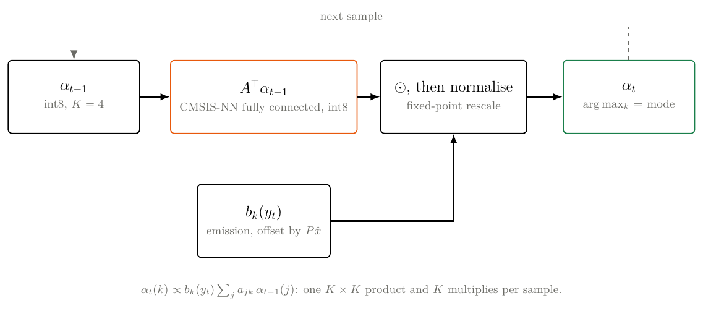

Figure 4. The per-sample recursion. The product A^T alpha_(t-1) has the same shape as a fully connected layer, so it runs on the int8 fully connected kernel in CMSIS-NN. The emission term uses the lifted offsets, and a fixed-point rescale keeps the belief normalised so that it does not underflow. The largest entry of alpha_t is the current behavioural mode, evaluated locally with no round trip to the GPU.

The prediction step uses the CMSIS-NN kernel when `HMM_USE_CMSIS_NN` is defined. Otherwise a portable C99 kernel with the same integer semantics is used, which is how the host tests run. The four regimes keep a direct calm-to-panic transition, which survives quantisation.

#### Device side: Arm CMSIS-NN forward filtering

Cortex-M microcontrollers do not have the memory or floating-point throughput to run sparse Cholesky factorisations on large meshes. They SHALL run only the forward filtering step: predicting the next state and updating it with local sensor measurements, once per sample.

| Aspect | Design | In this repository |
|---|---|---|
| Quantised execution | CMSIS-NN provides int8 and int16 kernels. The forward filter is expressed in kernel form: a state-transition operator as a fully connected layer and, for filters over the field itself, as 1D or 2D convolutions or graph message passing over local mesh neighbourhoods. | The 4 by 4 transition product A^T alpha_(t-1) runs as `arm_fully_connected_s8` when `HMM_USE_CMSIS_NN` is defined, with a portable C99 kernel of identical integer semantics otherwise. A field-level filter in convolution or message-passing form is not implemented. |
| Locality | A GMRF node depends only on its immediate neighbours, so the sparse products in a forward filter reduce to small, local multiply-accumulate (MAC) operations, which CMSIS-NN executes with the SIMD instructions available on Cortex-M cores. | The four-regime recursion needs 16 MACs, four multiplies and a fixed-point normalisation per sample. Belief underflow is prevented by rescaling. |
| Memory and latency | Small state and local operations keep RAM use and per-sample cost low. | Footprint measured with arm-none-eabi-gcc 13.2.1: 1,802 bytes of flash, 16 bytes of state and at most 216 bytes of stack, excluding the runtime division routine (see [Operation Counts and Footprint](#device-static-footprint)). Latency is not measured. |

#### Device: per sample

| Stage | Matrix | Entries | MACs |
|---|---|---|---|
| Prediction A^T alpha_(t-1) | A^T (4x4, int8) | 16 | 16 |
| Emission b_k(y_t) | mu, 1/sigma (4x2) and P x_hat | 8 | 16 |
| Update and normalise | belief alpha_t (4, int8) | 4 | 8 |
| Total per sample |  |  | 40 |

The device count is read from the loops of `hmm_step` and does not depend on the mesh: a test checks that it is 40 MACs for both an 8 by 8 and a 16 by 16 mesh. The only link from the field to the device is one int16 lifted offset per site, P x_hat, from the 64 by 256 projector with 192 nonzeros.

#### Device: static footprint

Measured in the captures workflow (Figure 14): the portable filter and the generated model cross-compiled with arm-none-eabi-gcc 13.2.1 (Ubuntu package `15:13.2.rel1-2`) for Cortex-M4F at `-Os` (`-mcpu=cortex-m4 -mthumb -mfloat-abi=hard -mfpu=fpv4-sp-d16`). Section sizes are read with `arm-none-eabi-size` and `firmware/tools/footprint.py`; stack frames are read with `-fstack-usage` and `-fcallgraph-info=su`.

| Unit | text (bytes) | rodata (bytes) | bss (bytes) |
|---|---|---|---|
| hmm_filter.c | 816 | 0 | 0 |
| hmm_fc_s8_ref.c | 198 | 0 | 0 |
| hmm_exp_lut.c (exp2 table, 256 x uint16) | 0 | 512 | 0 |
| Generated model (A^T, emission constants, 64 offsets) | 0 | 276 | 0 |
| Filter state | 0 | 0 | 16 |
| Total | 1,014 | 788 | 16 |

| Function | Stack frame (bytes) |
|---|---|
| hmm_step | 168 |
| hmm_fc_s8 | 0 (tail call) |
| hmm_fc_s8_ref | 40 |
| hmm_requantize | 8 |
| hmm_exp_neg_q15 | 8 |

Flash use for the filter and model objects is 1,802 bytes and RAM use is 16 bytes of state, with a stack depth of at most 216 bytes along hmm_step, hmm_fc_s8, hmm_fc_s8_ref and hmm_requantize. The normalisation divides 64-bit integers, which calls `__aeabi_ldivmod` four times per sample. Linked with libgcc alone (`-nostartfiles -nostdlib --gc-sections`), the image is 2,676 bytes (`.text` 1,880, `.rodata` 788, `.ARM.exidx` 8), of which `__udivmoddi4` accounts for 700 bytes. The stack figure excludes the frame of `__aeabi_ldivmod`.

Not measured: cycles or latency per sample on a Cortex-M device, and GPU time per evaluation of theta. A MAC count is not a latency; no time figure SHALL be derived from this table without a measurement on the target.

The CMSIS-NN backend, built against CMSIS-NN v8.0.0 and the CMSIS_6 v6.4.0 core headers, adds `hmm_fc_s8_cmsis.c` (176 bytes of text and a 256-byte scratch buffer in bss) and the kernels `arm_fully_connected_s8` (110), `arm_fully_connected_s8_get_buffer_size` and its variants (14) and `arm_nn_vec_mat_mult_t_s8` (1,290), 1,590 bytes of text in total (Figure 15).

Status recorded by the captures workflow: both builds of the firmware tests, with the portable kernel and with CMSIS-NN v8.0.0 `arm_fully_connected_s8` (`HMM_USE_CMSIS_NN`), were cross-compiled for Cortex-M4F and run under `qemu-arm` 8.2.2 user-mode emulation with semihosting. Both report `bit_exact_vs_python=yes` over the 600 committed test vectors and `firmware tests: all passed` (Figure 15). QEMU emulates the instruction set only; it gives no cycle count, and no latency is claimed. No CMSIS-NN release is pinned in this repository; v8.0.0 is the release the capture used.

### 4. CARLA simulation loop and the Android application

#### Simulation Loop with CARLA

This section follows the journal entry [Hidden States: Modelling Driver Behaviour with CARLA, CUDA and a Microcontroller in the Loop](https://whatheheckisthis.github.io/blog/hidden-states-behavioural-time-series/), which describes the closed loop the study was designed around. The CARLA integration is described here for completeness and is not implemented in this repository.

Studying regime changes conventionally requires an instrumented vehicle or driving simulator rig, physiological sensors, roadside cameras and an edge computer. The study asked whether the same question could be studied credibly with simulation and a single low-cost microcontroller.

```
 +-------------------+     frames      +----------------------------+
 |  CARLA simulator  | --------------> |  OpenCV preprocessing      |
 |  scenarios, ego   |                 |  resize, normalise, ROI    |
 |  vehicle, sensors |                 +-------------+--------------+
 +---------^---------+                               |
           |                                         v
           |                           +----------------------------+
           |                           |  CUDA GPU (near time)      |
           |                           |  R-CNN object detection    |
           |                           |  feature extraction        |
           |                           +-------------+--------------+
           |                                         | compact feature
           |                                         | vector (UART)
           |                                         v
           |    regime estimate        +----------------------------+
           +-------------------------- |  MCU (hard real time)      |
              (closes the loop)        |  int8 HMM forward filter   |
                                       +----------------------------+
```

CARLA renders the scene and the camera streams. OpenCV prepares each frame; the lane detection in this repository is the OpenCV component that yields the lateral offset and SDLP observations. The GPU runs region-based convolutional neural network (R-CNN) detection and reduces each frame to a small feature vector. The MCU receives that vector and updates its belief over the four regimes. The estimate is returned to the simulation, so the scenario can respond to it.

#### Why the GPU handles perception

R-CNN detection is expensive, irregular in cost and tolerant of small delays, so it belongs off the real-time path. CUDA allows the GPU to process detection in near time, in batches, while the regime filter continues to run at a fixed rate on the latest available features. The heavy path determines what the model sees; it does not determine when the model decides.

#### Why a microcontroller rather than a Raspberry Pi

| Consideration | Raspberry Pi (Linux) | Microcontroller (bare metal) |
|---|---|---|
| Timing | Scheduler jitter from the OS | Deterministic, cycle-bounded loop |
| Workload fit | Capacity largely unused | Matches a 4 by 4 recursion |
| Representativeness | Unlike an embedded target | The class of device that ships |
| Power and cost | Higher | Lower |

A general-purpose computer adds capacity the task does not use and timing behaviour the task cannot tolerate. The firmware in `firmware/` is written for that bare-metal class of device.

#### Why no edge computing was required

An edge deployment answers a deployment question: where processing runs once sensors exist in the world. The study asked a modelling question: whether the two-layer model detects regime changes correctly and within a time budget. CARLA supplied the sensors, the GPU workstation supplied perception, and the MCU supplied the time-critical decision.

```
 Conventional study                         This approach
 ------------------                         -------------
 instrumented vehicle or rig      --->      CARLA scenarios
 physiological and road sensors   --->      simulated camera and vehicle signals
 edge computer for perception     --->      CUDA GPU workstation
 embedded decision unit           --->      MCU in the simulation loop
```

The study assumes that perception does not need to complete within one control cycle, provided the regime filter receives a timely summary, and that a simulated sensor stream is a sufficient proxy for early-stage model design but not a substitute for validation on recorded data.

#### CARLA Driving Videos

The application bundles four 15-second dashcam clips rendered in CARLA under [`assets/videos/`](assets/videos/), as sample input for the lane detector: two clear-weather urban drives and one rain-at-sunset urban drive in Town10HD, and one wet highway drive at sunset in Town04. They are H.264 Baseline at 640 x 384 and 20 frames per second, so they play on older Android devices. The clips come from the CC BY 4.0 mini-carla-192x320 dataset rendered with CARLA 0.9.16; per-clip episode, frame range, camera intrinsics and licence are in [`assets/videos/README.md`](assets/videos/README.md). No lane detection accuracy has been measured on them.

Each preview below is a 5-second excerpt; select it to open the full clip.

| Town10HD, urban, clear | Town10HD, urban, clear |
|---|---|
| [](assets/videos/carla_town10hd_urban_clear_ep04.mp4) | [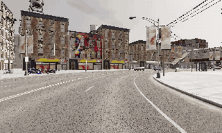](assets/videos/carla_town10hd_urban_clear_ep09.mp4) |
| **Town10HD, urban, rain at sunset** | **Town04, highway, wet at sunset** |
| [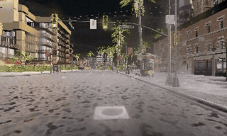](assets/videos/carla_town10hd_urban_rain_sunset_ep19.mp4) | [](assets/videos/carla_town04_highway_wet_sunset_ep18.mp4) |

Video frames: CARLA simulator via mini-carla-192x320, CC BY 4.0.

Figure 16 shows four still frames from each clip. The Android application itself (the Java sources and `AndroidManifest.xml` at the repository root) is not built in CI and has not been run for this README.

## Scope

In scope:

- FEM mesh assembly, the SPDE precision Q(theta) and its sparse Cholesky factorisation, with a CPU reference and a CUDA path (cuSPARSE and cuDSS).
- The sparse projector P, with three barycentric weights per sensor.
- The ordering and fill-in result, reverse Cuthill-McKee against a scrambled node order.
- The int8 forward filter for Cortex-M, with a CMSIS-NN backend and a portable C99 reference, checked against a floating-point filter.

Out of scope:

- GPU timings, device latency on Cortex-M, and accuracy on recorded drives.
- Fitting the transition and emission parameters to recorded data.
- Backward sampling and the EM or Laplace update of the regime parameters described in case study 03.
- The CARLA simulation loop, R-CNN detection and the UART link to the MCU described in the study's journal entry.

Known limitations:

- The CUDA code in `gpu/` compiles with nvcc 12.9 against cuDSS 0.7.1.6 but not against cuDSS 1.0.0.35 (Figure 12). It has not been linked or run, and it MUST be checked against `gpu/compare.py` on a GPU before any GPU result is reported.
- The CMSIS-NN backend is bit-exact against the Python reference with CMSIS-NN v8.0.0 under QEMU (Figure 15). No release is pinned, and it has not run on a physical target.
- All test data are simulated with fixed seeds.

### Lineage

| Period            | Status                                                                                              |
|-------------------|------------------------------------------------------------------------------------------------------|
| 2014              | Original application developed by Wahib-ul-Haq as an MSc Computer Science semester project at TUM   |
| Summer 2019       | Derived into an advanced driver assistance systems (ADAS) venture                                   |
| October 2024      | ADAS venture incorporated                                                                            |
| April 2025        | Venture disbanded; codebase refactored                                                               |
| 17 November 2026  | Revived, following tacit approval, as part of the SPDE-GMRF study                                    |

### Motivation

A dashboard-mounted phone can detect lane markings and estimate the Standard Deviation of Lane Position (SDLP), a common measure of lateral control. Lane position alone does not explain why control changes. A driver moves between a small number of behavioural modes (calm, alert, high stress and panic) and drifts gradually within each mode. The model separates the two: a hidden Markov model for the modes and a sparse Gaussian field (SPDE-GMRF) for the drift.

### Objectives

1. Estimate the field and its parameters on a GPU, where large sparse factorisations belong.
2. Lift the field estimate to sensor locations with a sparse projector.
3. Decide the current mode on the device with one small int8 recursion per sample.
4. Check the int8 recursion against a floating-point reference before any latency claim is made.

### Assumptions

- Observations are a lateral lane offset and an SDLP window, both in millimetres.
- The field enters the lateral offset channel only, through the lifted offset of the current site.
- Transition and emission parameters are illustrative and have not been fitted to recorded data.
- All data used by the tests are simulated with fixed seeds.

## Architecture

### Technology stack

| Layer | Component | Role | Status in this repository |
|---|---|---|---|
| Host, NVIDIA | CUDA | GPU runtime for estimation | Code in `gpu/`; compiles with nvcc 12.9 against cuDSS 0.7.1.6; not linked or run |
| Host, NVIDIA | cuSPARSE | Q in CSR form, sparse products (`cusparseSpMM`) | Used in `gpu/src/spde_gpu.cu` |
| Host, NVIDIA | cuDSS | SPD Cholesky: analysis once, refactorisation and solve per theta, factor diagonal for log\|Q\| | Used in `gpu/src/spde_gpu.cu` |
| Host, NVIDIA | cuSOLVER | Dense sub-problems; sparse Cholesky module named in the case study, now deprecated | Not used |
| Host, CPU reference | Python, NumPy, SciPy | FEM assembly, symbolic and numeric Cholesky, estimation, export | Tested in CI |
| Device, Arm | Cortex-M4F | Target for the int8 forward filter | Cross-compiled with arm-none-eabi-gcc 13.2.1 at `-Os`; 1,802 bytes of flash, 16 bytes of state, at most 216 bytes of stack; run under QEMU |
| Device, Arm | CMSIS-NN | `arm_fully_connected_s8` for A^T alpha_(t-1) | Built against CMSIS-NN v8.0.0; bit-exact under QEMU |
| Device, portable | C99 | Reference int8 kernel with identical integer semantics | Built with gcc in CI; bit-exact with the Python integer version |
| Simulation | CARLA, OpenCV, R-CNN | Closed loop described in the journal entry | Design only |

### Heavy path and light path

The model has a heavy part and a light part. Estimating the spatial field and its parameters means factorising large sparse precision matrices, which belongs on a GPU. Deciding the current behavioural mode means one small recursion per sample, which belongs on the device.

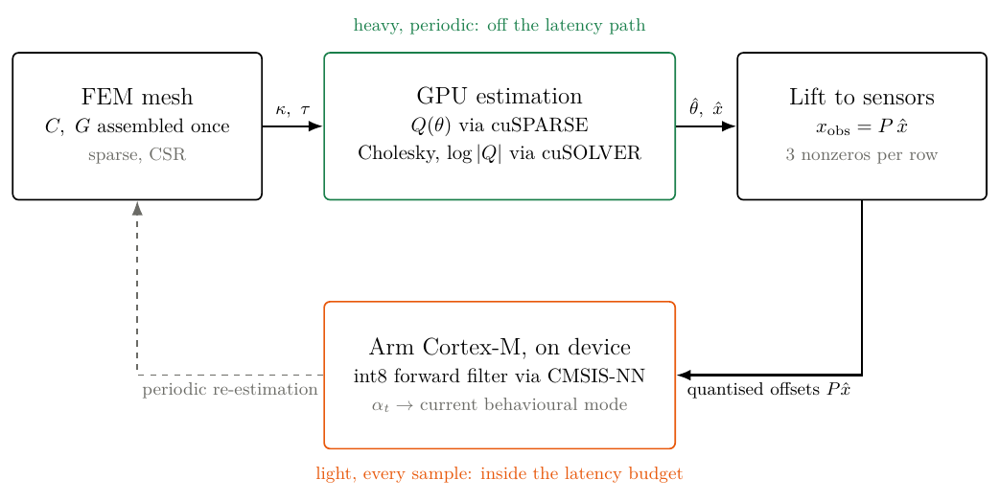

Figure 1. Heavy path and light path. The mesh matrices C and G are assembled once. The GPU rebuilds Q(theta), factorises it and returns theta_hat and the field estimate x_hat. Those are lifted to the sensor locations and quantised for the device, which runs the forward filter on every sample. Re-estimation runs periodically, off the latency path.

```
 FEM mesh: C (lumped), G             assembled once
        |
        v
 +--------------------------------+   Q(theta) = tau^2 (kappa^4 C + 2 kappa^2 G + G C^-1 G)
 | Estimation (GPU; CPU reference)|   fixed pattern, symbolic analysis once,
 | sparse Cholesky, log|Q| =      |   numeric refactorisation per theta
 | 2 sum log L_ii, (kappa, tau)   |
 +---------------+----------------+
                 |  x_hat
                 v
 +--------------------------------+   each row of P: three barycentric weights,
 | Lift: offsets = P x_hat        |   summing to one
 +---------------+----------------+
                 |  int8 A^T, offsets, emission constants
                 v
 +--------------------------------+   alpha_t(k) ~ b_k(y_t) sum_j a_jk alpha_{t-1}(j)
 | Forward filter (Cortex-M)      |   A^T alpha as arm_fully_connected_s8;
 | argmax = current mode          |   fixed-point rescale prevents underflow
 +--------------------------------+
        ^                                    |
        +---- periodic re-estimation --------+  (off the latency path)
```

### Why the split works

The expensive work, factorising a large sparse precision, depends only on how fast the environment changes, so it can run every few seconds or minutes. The cheap work depends on every sample, and its cost is fixed by the number of regimes, not by the size of the field.

## Repository layout

```
python/spdegmrf/   mesh, FEM assembly, SPDE precision, sparse Cholesky, projector,
                   estimation, lattice fill-in, float HMM filter, int8 quantisation, export
python/tests/      unit tests for every module above
python/tools/      fill-in figure script and operation-count table
gpu/               CUDA estimation with cuSPARSE and cuDSS, CMake, CPU comparison script
firmware/          C99 forward filter, portable int8 kernel, CMSIS-NN backend, host tests,
                   Cortex-M4F footprint script
assets/videos/     CARLA dashcam clips bundled with the application, with provenance
docs/videos/       GIF previews of the CARLA clips shown in this README
docs/              regenerated fill-in figure; docs/figures/ holds the case study figures
docs/capture/      capture script and plotting script for the Figures section
docs/screenshots/  figures and logs written by the captures workflow
.github/workflows/ continuous integration
```

The Android project files at the repository root are retained from the original application.

## Requirements

- Python 3.11 with the packages in `python/requirements.txt`.
- A C99 compiler and make for the firmware host tests. CI uses gcc on Ubuntu.
- For the GPU path only: CUDA, cuSPARSE, cuDSS and CMake. These are not required for the tests.
- For a Cortex-M build only: the CMSIS-NN release the build pins, with `HMM_USE_CMSIS_NN` defined.
- For the captures only: Xvfb, xterm, xdotool, ImageMagick, arm-none-eabi-gcc with newlib, qemu-user, matplotlib, pyelftools and imageio-ffmpeg, as installed by [`.github/workflows/captures.yml`](.github/workflows/captures.yml).

## Build and Test

```
pip install -r python/requirements.txt
python -m pytest -s                  # Python reference and C kernel cross-check
make -C firmware test                # host build of the forward filter
python -m spdegmrf.export            # from python/: regenerate firmware headers
python python/tools/mac_table.py     # operation counts per stage, from the matrices
(cd firmware && python tools/footprint.py)   # Cortex-M4F footprint; needs pyelftools and CC_M4
```

On a machine with CUDA and cuDSS:

```
cmake -S gpu -B gpu/build && cmake --build gpu/build
(cd python && python -m spdegmrf.export --gpu-case ../case.bin)
./gpu/build/spde_gpu case.bin > gpu.csv && python gpu/compare.py gpu.csv
```

Continuous integration runs the Python tests and the firmware host tests on Ubuntu. The GPU build is excluded because hosted runners have no GPU.

### Test counts

| Check | Command | Result in the captures workflow |
|---|---|---|
| Python reference and C kernel cross-check | `CC=gcc python -m pytest -v -s` | 20 passed in 6.50 s, Python 3.11.18 (Figure 5) |
| Firmware host tests | `make -C firmware test CC=gcc WERROR=1` | 8 test functions, `firmware tests: all passed`, gcc 13.3.0 (Figure 13) |
| Firmware tests on Cortex-M4F, portable kernel | `qemu-arm -cpu cortex-m4` | `bit_exact_vs_python=yes`, all passed (Figure 15) |
| Firmware tests on Cortex-M4F, CMSIS-NN v8.0.0 kernel | `qemu-arm -cpu cortex-m4` | `bit_exact_vs_python=yes`, all passed (Figure 15) |
| Operation counts | `python python/tools/mac_table.py` | identical to the tables in features 2 and 3 (Figure 6) |
| CUDA estimation | `nvcc -c gpu/src/spde_gpu.cu` | compiles with cuDSS 0.7.1.6; fails with cuDSS 1.0.0.35 (Figure 12) |

The firmware vector test covers 600 committed samples and reports an int8 against float mode agreement of 0.9933 on them; the 99.66% in the Evidence table is the Python test over 5,000 samples. Both runs report 0 floor hits. The CI workflow [`.github/workflows/ci.yml`](.github/workflows/ci.yml) runs the pytest suite and the firmware host tests on every push.

### Evidence

The following figures are produced by the tests on simulated data.

| Quantity                                                   | Result                                     |
|------------------------------------------------------------|--------------------------------------------|
| 10 by 10 lattice, n = 100, nonzeros of Q (case study 03)      | 1,104                                      |
| 20 by 20 lattice, n = 400, nonzeros of Q                    | 4,804                                      |
| Cholesky factor nonzeros after reverse Cuthill-McKee        | 11,378                                     |
| Cholesky factor nonzeros, scrambled order (seeds 0, 1, 2)  | 45,258; 44,510; 43,640                     |
| Reduction from reordering                                  | 74.9%, 74.4%, 73.9%                        |
| Rows of P with exactly three weights summing to one         | all rows                                   |
| Estimated kappa and tau, relative error (16 by 16 mesh)     | 3.0% and 2.9%                              |
| int8 against float, mode agreement (5,000 samples)          | 99.66%                                     |
| int8 against float, mean absolute belief error             | 0.0020                                     |
| C kernel against Python integer mirror                      | bit-exact                                  |

The figure can be regenerated with `python python/tools/fill_in_figure.py docs/spde-fill-in.png`.

Not yet measured: GPU timings, device latency on Cortex-M, and accuracy on recorded drives. No latency claim SHALL be made until these are measured.

The captures workflow adds two results on the 20 by 20 lattice (Figure 10, [`docs/screenshots/plots.log`](docs/screenshots/plots.log)). Over 1,000 uniform random relabellings (NumPy `default_rng` seeds 0 to 999), the scrambled factor has between 34,195 and 48,532 nonzeros, with a median of 42,308; 2.5% of the relabellings give 37,615 or fewer, and none of them gives exactly 37,615. The case study count is therefore consistent with one random relabelling, and at 37,615 the reduction to 11,378 is 69.8%, the "about 70%" that the study reports. Reverse Cuthill-McKee applied to each scrambled matrix does not always give 11,378: in the run that produced the committed figures, 500 of the 1,000 seeds give 11,378 and the other 500 give 11,370, and in an earlier run of the same workflow the split was 502 and 498. Seeds 0, 1 and 2, which the tests use, gave 11,378 in every run. The RCM count therefore depends on the input labelling, and the variation between runs shows that it can also depend on the run; the cause of that variation has not been established.

## Figures

All figures in this section are generated by [`.github/workflows/captures.yml`](.github/workflows/captures.yml) on an `ubuntu-24.04` runner from the sources in this repository, using [`docs/capture/capture.sh`](docs/capture/capture.sh) and [`docs/capture/plots.py`](docs/capture/plots.py). Terminal figures are screenshots, taken with ImageMagick `import`, of xterm running the named commands on an Xvfb display; plots are written by matplotlib from arrays computed by `python/spdegmrf`; the frame grid is cut from the bundled clips with ffmpeg. No figure is drawn by hand or edited beyond cropping. The log of each run is kept next to its image in [`docs/screenshots/`](docs/screenshots/), and tool versions are in [`docs/screenshots/versions.log`](docs/screenshots/versions.log). Nothing that needs a GPU, a phone or a board was captured: there are no GPU timings, no device latencies, no cycle counts and no Android screenshots. Figures 1 to 4 are case study figures and are not regenerated by the workflow. Select any figure to open it at full resolution.

| Figure | Subject | Tool | Source |
|---|---|---|---|
| 1 | Heavy path and light path | Case study figure | `docs/figures/spde-pipeline.png` |
| 2 | One sensor, three weights | Case study figure | `docs/figures/spde-lifting.png` |
| 3 | Ordering decides the cost | Case study figure; regenerated as `docs/spde-fill-in.png` by `python/tools/fill_in_figure.py` | `docs/figures/spde-fill-in.png` |
| 4 | The per-sample recursion | Case study figure | `docs/figures/spde-forward-filter.png` |
| 5 | pytest run | pytest 9.2.0, Python 3.11.18, gcc 13.3.0 | `python/tests/` |
| 6 | Operation counts | Python 3.11.18, NumPy 2.4.6, SciPy 1.17.1 | `python/tools/mac_table.py` |
| 7 | Simulated field, observations and posterior mean | matplotlib 3.11.2 | `python/spdegmrf/export.py`, `estimate.py` |
| 8 | Marginal log-likelihood over (kappa, tau) | matplotlib 3.11.2 | `python/spdegmrf/estimate.py` |
| 9 | Sparsity of Q and of its Cholesky factor | matplotlib 3.11.2 | `python/spdegmrf/lattice.py`, `cholesky.py` |
| 10 | Scrambled-order fill-in over 1,000 relabellings | matplotlib 3.11.2 | `python/spdegmrf/lattice.py`, `cholesky.py` |
| 11 | Float and int8 forward filters | matplotlib 3.11.2 | `python/spdegmrf/hmm.py`, `quant.py` |
| 12 | CUDA compile against two cuDSS releases | nvcc 12.9.86, cuDSS 0.7.1.6 and 1.0.0.35 | `gpu/src/spde_gpu.cu` |
| 13 | Firmware host tests | gcc 13.3.0, make | `firmware/tests/test_hmm_filter.c` |
| 14 | Cortex-M4F static footprint | arm-none-eabi-gcc 13.2.1, arm-none-eabi-size, pyelftools | `firmware/src/`, `firmware/tools/footprint.py` |
| 15 | Firmware tests on Cortex-M4F, portable and CMSIS-NN kernels | arm-none-eabi-gcc 13.2.1, qemu-arm 8.2.2, CMSIS-NN v8.0.0 | `firmware/tests/test_hmm_filter.c`, `firmware/src/hmm_fc_s8_cmsis.c` |
| 16 | CARLA still frames | ffmpeg (imageio-ffmpeg build), ImageMagick 6.9.12 | `assets/videos/*.mp4` |

### Python reference

<p align="center">
  <a href="docs/screenshots/terminal_pytest.png"></a>
  <br>
  <sub><b>Figure 5.</b> The 20 tests in <code>python/tests/</code>, run with <code>CC=gcc</code> so that the C kernel cross-check runs: all 20 pass in 6.50 s. The printed lines show the estimates of kappa and tau (relative errors 3.0% and 2.9%, 177 numeric factorisations after 2 symbolic analyses), the scrambled and RCM factor counts for seeds 0, 1 and 2, and the int8 against float agreement over 5,000 samples. Log: <a href="docs/screenshots/terminal_pytest.log">terminal_pytest.log</a>.</sub>
</p>

<p align="center">
  <a href="docs/screenshots/terminal_mac_table.png"></a>
  <br>
  <sub><b>Figure 6.</b> Operation counts per stage from <code>python/tools/mac_table.py</code>, computed from the sparsity pattern of each matrix. Every row equals the corresponding row of the tables in features 2 and 3. Log: <a href="docs/screenshots/terminal_mac_table.log">terminal_mac_table.log</a>.</sub>
</p>

<p align="center">
  <a href="docs/screenshots/plot_field_estimate.png"></a>
  <br>
  <sub><b>Figure 7.</b> The pipeline of <code>spdegmrf.export.run_pipeline</code> (seed 2026) on the 16 by 16 mesh over 1.5 km, n = 256. Left: the 200 sensor observations of the eighth replicate over the mesh triangles. Centre: the simulated field, kappa = 4.714 and tau = 0.00150. Right: the posterior mean at the estimates kappa_hat = 4.574 and tau_hat = 0.00145, with the 64 route sites coloured on the same scale by their lifted offsets P_dev x_hat (from -88.6 to 9.6 mm), so that each site matches the field beneath it. The script checks that its estimate and offsets equal those of <code>run_pipeline</code>.</sub>
</p>

<p align="center">
  <a href="docs/screenshots/plot_loglik_surface.png"></a>
  <br>
  <sub><b>Figure 8.</b> The marginal log-likelihood of <code>Estimator.loglik</code> on a 25 by 25 grid of (kappa, tau), relative to the grid maximum; white contours at -2, -5, -10 and -20. The 625 evaluations used 1,250 numeric factorisations and the 2 symbolic analyses made once. The cross marks the Nelder-Mead estimate and the plus sign the value used in the simulation.</sub>
</p>

<p align="center">
  <a href="docs/screenshots/plot_sparsity.png"></a>
  <br>
  <sub><b>Figure 9.</b> Left: Q on the 10 by 10 lattice, 1,104 nonzeros, at most 13 per row (case study 03, Figure 3). Centre and right: the Cholesky factor of Q on the 20 by 20 lattice after the seed 0 relabelling, 45,258 nonzeros, and after reverse Cuthill-McKee, 11,378 nonzeros.</sub>
</p>

<p align="center">
  <a href="docs/screenshots/plot_fill_in_seeds.png"></a>
  <br>
  <sub><b>Figure 10.</b> Factor nonzeros on the 20 by 20 lattice for 1,000 uniform random relabellings (seeds 0 to 999): minimum 34,195, median 42,308, maximum 48,532. The case study count of 37,615 lies at the 2.5th percentile; seed 0 of this repository gives 45,258. The RCM line is the seed 0 value; across the 1,000 seeds RCM gives 11,378 or 11,370 (see <a href="#evidence">Evidence</a>).</sub>
</p>

<p align="center">
  <a href="docs/screenshots/plot_forward_filter.png"></a>
  <br>
  <sub><b>Figure 11.</b> The data of <code>python/tests/test_forward_filter.py</code> (seed 7), first 600 of 5,000 samples. From the top: the two observation channels; the simulated regime and the int8 mode; the float forward filter posterior; and the int8 belief of <code>quant.Int8Filter</code>, dequantised as (alpha + 128) / 255 and normalised. Over all 5,000 samples the argmax agreement is 99.66% and the mean absolute belief error is 0.0020. All data are simulated.</sub>
</p>

### GPU estimation

<p align="center">
  <a href="docs/screenshots/terminal_nvcc.png">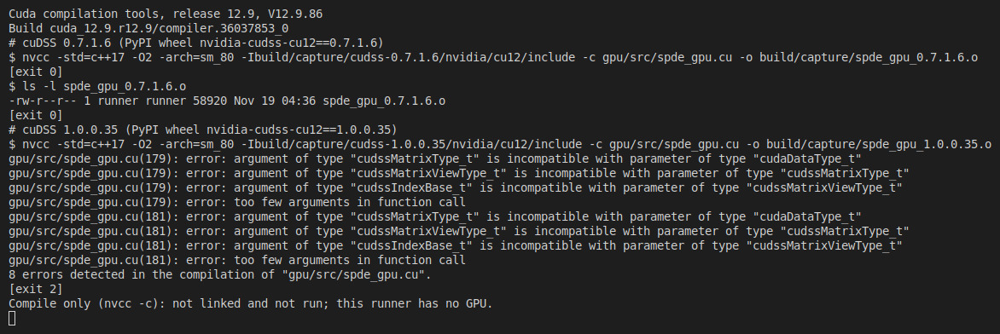</a>
  <br>
  <sub><b>Figure 12.</b> nvcc 12.9.86 compiles <code>gpu/src/spde_gpu.cu</code> against the cuDSS 0.7.1.6 headers. Against cuDSS 1.0.0.35 it stops with eight errors at lines 179 and 181, where <code>cudssMatrixCreateCsr</code> now takes an <code>offsetType</code> argument. Compile only: the object is not linked or run, because the runner has no GPU. Log: <a href="docs/screenshots/terminal_nvcc.log">terminal_nvcc.log</a>.</sub>
</p>

### Firmware

<p align="center">
  <a href="docs/screenshots/terminal_fw_host.png">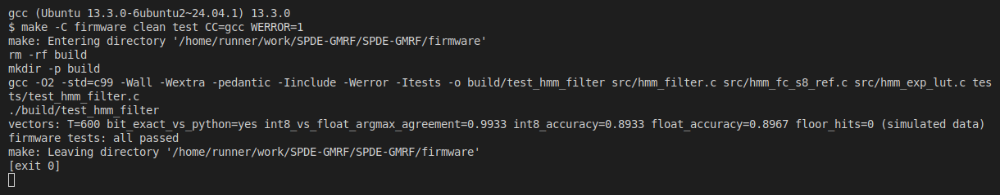</a>
  <br>
  <sub><b>Figure 13.</b> <code>make -C firmware test CC=gcc WERROR=1</code> with gcc 13.3.0: the portable filter matches the Python integer mirror bit for bit over the 600 committed vectors, and all tests pass. Log: <a href="docs/screenshots/terminal_fw_host.log">terminal_fw_host.log</a>.</sub>
</p>

<p align="center">
  <a href="docs/screenshots/terminal_fw_m4_size.png">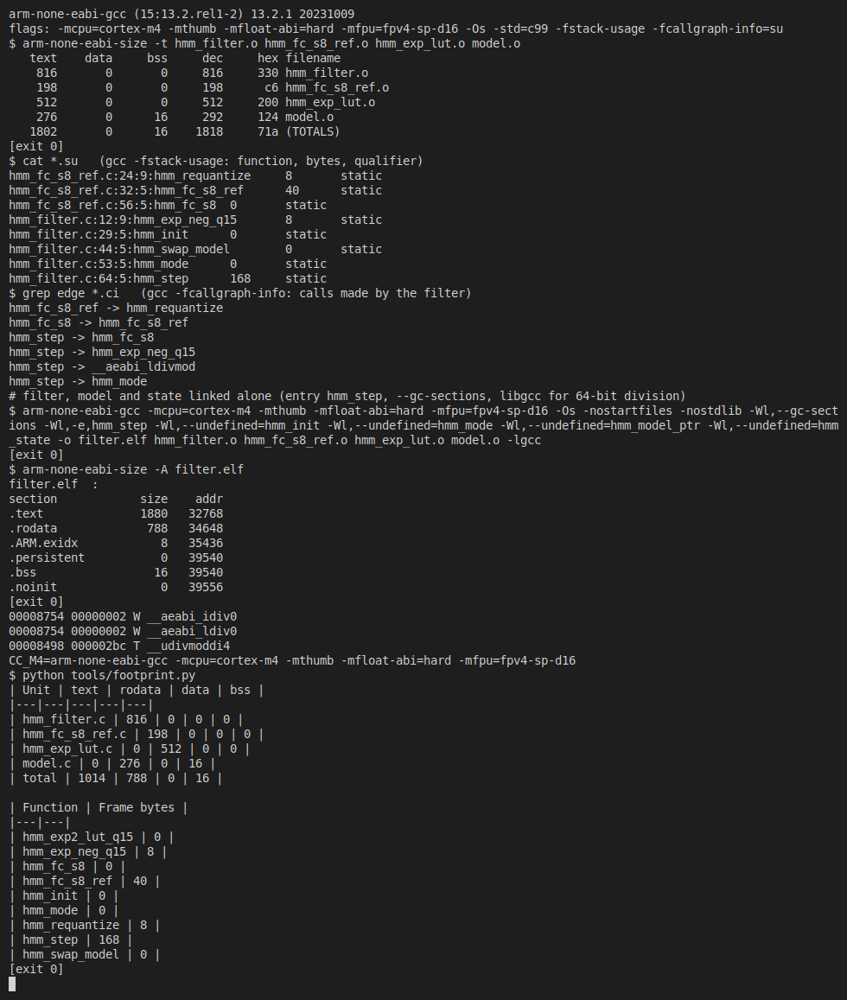</a>
  <br>
  <sub><b>Figure 14.</b> Cortex-M4F build with arm-none-eabi-gcc 13.2.1 at <code>-Os</code>: section sizes of the filter, kernel, exp2 table and generated model (1,014 bytes of text, 788 of rodata, 16 of bss), stack frames from <code>-fstack-usage</code>, the call graph from <code>-fcallgraph-info</code>, the linked image with libgcc (<code>.text</code> 1,880 bytes, <code>__udivmoddi4</code> 700 bytes), and the same objects measured by <code>firmware/tools/footprint.py</code>. Log: <a href="docs/screenshots/terminal_fw_m4_size.log">terminal_fw_m4_size.log</a>.</sub>
</p>

<p align="center">
  <a href="docs/screenshots/terminal_fw_m4_qemu.png"></a>
  <br>
  <sub><b>Figure 15.</b> The firmware tests cross-compiled for Cortex-M4F with newlib semihosting and run under <code>qemu-arm -cpu cortex-m4</code>: first with the portable kernel, then with CMSIS-NN v8.0.0 <code>arm_fully_connected_s8</code>. Both are bit-exact with the Python mirror and pass. QEMU gives no cycle counts. Log: <a href="docs/screenshots/terminal_fw_m4_qemu.log">terminal_fw_m4_qemu.log</a>.</sub>
</p>

### CARLA clips

<p align="center">
  <a href="docs/screenshots/carla_frame_grid.png"></a>
  <br>
  <sub><b>Figure 16.</b> Frames 0, 100, 200 and 299 (t = 0, 5, 10 and 14.95 s) of each bundled clip, scaled to the 320 by 192 capture resolution: Town10HD urban in clear weather (episodes 4 and 9), Town10HD urban in rain at sunset (episode 19) and Town04 highway on a wet road at sunset (episode 18). Video frames: CARLA simulator via mini-carla-192x320, CC BY 4.0. Stream details: <a href="docs/screenshots/carla_frame_grid.log">carla_frame_grid.log</a>.</sub>
</p>

## Security

Commits SHALL be signed with the maintainer key in [KEYS.asc](KEYS.asc). Verification steps and vulnerability reporting are in [SECURITY.md](SECURITY.md).

## Attribution

- Original application and project report, *Computer Vision on Nomadic Devices for Human Factors Engineering*, by Wahib-ul-Haq (TUM): [project report](https://www.academia.edu/11329425/Computer_vision_on_nomadic_devices_for_human_factors_engineering).
- Core lane detection based on [lane-detection](https://github.com/jdorweiler/lane-detection) by J. Dorweiler, described in [Revisiting lane detection using OpenCV](http://www.transistor.io/revisiting-lane-detection-using-opencv.html), ported to the Android NDK and optimised for smartphones in the original application.
- Related case study: [Lifting SPDE-GMRF Fields: GPU Estimation and On-Device Forward Filtering](https://whatheheckisthis.github.io/case-studies/spde-gmrf-gpu-edge/).
- Journal entry: [Hidden States: Modelling Driver Behaviour with CARLA, CUDA and a Microcontroller in the Loop](https://whatheheckisthis.github.io/blog/hidden-states-behavioural-time-series/).
- [CARLA simulator](https://carla.org/). Bundled driving videos: [mini-carla-192x320](https://huggingface.co/datasets/kamwoh/mini-carla-192x320) by kamwoh, CC BY 4.0.
- Previous case study: [Hidden Markov models with Gaussian fields](https://whatheheckisthis.github.io/case-studies/hmm-gaussian-fields/), [Hidden Markov model overview](https://en.wikipedia.org/wiki/Hidden_Markov_model).
- Lindgren, Rue and Lindstrom, [An explicit link between Gaussian fields and Gaussian Markov random fields: the SPDE approach](https://doi.org/10.1111/j.1467-9868.2011.00777.x).
- NVIDIA [cuSPARSE](https://docs.nvidia.com/cuda/cusparse/), [cuDSS](https://docs.nvidia.com/cuda/cudss/) and [cuSOLVER](https://docs.nvidia.com/cuda/cusolver/) documentation; Arm [CMSIS-NN](https://github.com/ARM-software/CMSIS-NN).

## Licence

MIT. The original copyright notice (Copyright (c) 2014 wahib-ul-haq) is retained in [LICENSE](LICENSE). The CARLA videos in `assets/videos/` are CC BY 4.0.
