# android-opencv-lanedetection: SPDE-GMRF Estimation and On-Device Forward Filtering

[](https://docs.nvidia.com/cuda/)
[](https://docs.nvidia.com/cuda/cusparse/)
[](https://docs.nvidia.com/cuda/cudss/)
[](https://docs.nvidia.com/cuda/cusolver/)
[](https://developer.arm.com/Processors/Cortex-M4)
[](https://github.com/ARM-software/CMSIS-NN)

On-device lane detection for Android with OpenCV, revived as the perception front end for the case study Lifting SPDE-GMRF Fields: GPU Estimation and On-Device Forward Filtering. This repository implements the pipeline that study describes: a sparse SPDE precision estimated on a GPU, a sparse projector from mesh nodes to sensors, and an int8 forward filter for Arm Cortex-M. It is a system design with a tested reference implementation, not a benchmark; [Scope](#scope) states what has not been measured.

A dashboard-mounted phone can detect lane markings and estimate the Standard Deviation of Lane Position (SDLP), but lane position alone does not explain why lateral control changes. The model separates the small number of behavioural modes a driver moves between (calm, alert, high stress and panic) from the gradual drift within each mode. The application was developed in 2014 by Wahib-ul-Haq as an MSc Computer Science semester project at TUM, derived into an advanced driver assistance systems venture in summer 2019, incorporated in October 2024 and disbanded in April 2025, when the codebase was refactored. It was revived on 17 November 2026, following tacit approval, as part of the SPDE-GMRF study.

The key words MUST, MUST NOT, SHALL, SHOULD and MAY in this document are to be interpreted as described in BCP 14 (RFC 2119 and RFC 8174).

## Contents

- [Key features](#key-features)
  - [1. SPDE-GMRF and HMM model (Python reference)](#1-spde-gmrf-and-hmm-model-python-reference)
  - [2. GPU parameter estimation (host)](#2-gpu-parameter-estimation-host)
  - [3. On-device forward filtering (CMSIS-NN firmware)](#3-on-device-forward-filtering-cmsis-nn-firmware)
  - [4. CARLA simulation loop and the Android application](#4-carla-simulation-loop-and-the-android-application)
- [Scope](#scope)
- [Architecture](#architecture)
- [Repository layout](#repository-layout)
- [Requirements](#requirements)
- [Build and Test](#build-and-test)
- [Figures](#figures)
- [Security](#security)
- [Attribution](#attribution)
- [Licence](#licence)

## Key features

The repository has four parts. Each part names the code that runs and the check that covers it. Figures 2 to 13 are produced from these sources by [`.github/workflows/captures.yml`](.github/workflows/captures.yml); see [Figures](#figures).

| # | Feature | What runs | Checked by |
|---|---|---|---|
| 1 | [SPDE-GMRF and HMM model (Python reference)](#1-spde-gmrf-and-hmm-model-python-reference) | `python/spdegmrf`: mesh, FEM assembly, Q(theta), sparse Cholesky, projector, estimation of (kappa, tau), float and int8 forward filters, under Python 3.11 | 20 pytest tests (Figure 2); `python/tools/mac_table.py` (Figure 3); plots from the same code (Figures 4 to 8) |
| 2 | [GPU parameter estimation (host)](#2-gpu-parameter-estimation-host) | `gpu/src/spde_gpu.cu` with cuSPARSE and cuDSS | `gpu/compare.py` against the CPU reference on a GPU host (not run: no GPU in CI); nvcc 12.9 compile only (Figure 9); `test_gpu_case.py` checks the case file |
| 3 | [On-device forward filtering (CMSIS-NN firmware)](#3-on-device-forward-filtering-cmsis-nn-firmware) | `firmware/`: C99 int8 filter, portable kernel and CMSIS-NN backend | `make -C firmware test` with gcc (Figure 10); `arm-none-eabi-gcc` Cortex-M4F footprint (Figure 11); firmware tests under `qemu-arm` with both kernels (Figure 12); bit-exact pytest check of the C kernel |
| 4 | [CARLA simulation loop and the Android application](#4-carla-simulation-loop-and-the-android-application) | Android OpenCV lane detector at the repository root; CARLA clips in `assets/videos/` as sample input | Not checked in CI: the closed loop is a design, and the Android build needs the Android SDK and NDK. The clips are read by ffmpeg (Figure 13) |

### 1. SPDE-GMRF and HMM model (Python reference)

The model follows case study 03, [Hidden Markov Models with Gaussian Fields for Behavioural Time Series](https://whatheheckisthis.github.io/case-studies/hmm-gaussian-fields/). It has two latent layers. A hidden Markov model over K = 4 regimes captures the jumps between modes, and a Gaussian field with sparse precision Q(theta) absorbs the slow drift, so that the regimes stay few and interpretable. Each observation depends on both: y_t = mu_S + H x_t + e_t, with noise e_t ~ N(0, Sigma_S) set by the current regime. The transition matrix keeps a direct calm-to-panic path a_14, because the moments that matter most have no gradual build-up; the int8 model MUST retain a nonzero a_14 after quantisation, and the tests check this.

The SPDE approach of Lindgren, Rue and Lindstrom replaces the dense Matern covariance with a Gaussian Markov random field. For alpha = 2, Q = tau^2 (kappa^4 C + 2 kappa^2 G + G C^-1 G), where C is the lumped mass matrix and G the stiffness matrix; kappa sets the range, about sqrt(8 nu)/kappa with nu = alpha - d/2, and tau sets the variance. Given the regimes, the field is Gaussian with a precision that is still sparse, so one sparse Cholesky factor L gives its mean and log|Q| = 2 sum log L_ii at no extra cost.

The field lives on mesh nodes and the signals arrive at sensors. A sparse projector P lifts one to the other, y = mu_S + H P x + e: each sensor reads the three corners of its triangle, so each row of P has three barycentric weights that sum to one, and the posterior precision gains only local couplings. The device receives the lifted offsets P x_hat and runs the four-regime HMM on them. A reduced-rank Kalman filter or a learned surrogate would be alternative compact forms; neither is implemented.

Fill-in is controlled by ordering, so the factorisation SHOULD use a fill-reducing ordering (reverse Cuthill-McKee, AMD or METIS nested dissection). On the 20 by 20 lattice the factorisation costs 174,362 MACs after reverse Cuthill-McKee and 3,877,939 in a scrambled order (Figure 3). Figures 4 to 8 show the estimated field, the likelihood surface, the sparsity and fill-in results, and the float and int8 forward filters.

### 2. GPU parameter estimation (host)

Each likelihood evaluation for theta = (kappa, tau) rebuilds the values of Q(theta) on a fixed sparsity pattern, factorises it and reads log|Q| from the factor diagonal. cuSPARSE holds Q in CSR form (`cusparseCreateCsr`) and performs the sparse products (`cusparseSpMM`). cuDSS performs the SPD Cholesky factorisation: `CUDSS_PHASE_ANALYSIS` runs once, then `CUDSS_PHASE_REFACTORIZATION` and `CUDSS_PHASE_SOLVE` run for each theta, with `CUDSS_DATA_DIAG` for the factor diagonal. The case study names the sparse Cholesky module of cuSOLVER, which NVIDIA marks as deprecated, so a new build SHOULD use cuDSS, as this repository does. cuSOLVER is not used: theta has two components and is optimised on the host. The compile status is in Figure 9 and [Scope](#scope).

### 3. On-device forward filtering (CMSIS-NN firmware)

Cortex-M microcontrollers SHALL run only the forward filtering step. The device needs the lifted offsets P x_hat for its own sites and the transition matrix A, one int16 offset per site from the 64 by 256 projector with 192 nonzeros. With four regimes the step is alpha_t(k) proportional to b_k(y_t) sum_j a_jk alpha_(t-1)(j). The product A^T alpha_(t-1) has the shape of a fully connected layer and runs as `arm_fully_connected_s8` when `HMM_USE_CMSIS_NN` is defined; otherwise a portable C99 kernel with identical integer semantics is used, which is how the host tests run. A fixed-point rescale keeps the belief from underflowing, and the largest entry of alpha_t is the current mode. The step costs 40 MACs per sample whatever the mesh size; a test checks this for an 8 by 8 and a 16 by 16 mesh. A field-level filter in convolution or message-passing form is not implemented.

On Cortex-M4F at `-Os` with arm-none-eabi-gcc 13.2.1 (Figure 11), the filter and generated model use 1,802 bytes of flash (1,014 of text and 788 of rodata), 16 bytes of state and at most 216 bytes of stack, excluding the frame of `__aeabi_ldivmod`, which the 64-bit normalisation calls four times per sample. Linked with libgcc alone, the image is 2,676 bytes, of which `__udivmoddi4` accounts for 700. The CMSIS-NN v8.0.0 backend adds `hmm_fc_s8_cmsis.c` (176 bytes of text and a 256-byte scratch buffer in bss) and 1,590 bytes of kernel text (Figure 12).

### 4. CARLA simulation loop and the Android application

The journal entry [Hidden States: Modelling Driver Behaviour with CARLA, CUDA and a Microcontroller in the Loop](https://whatheheckisthis.github.io/blog/hidden-states-behavioural-time-series/) describes the closed loop the study was designed around. CARLA renders the scene; OpenCV prepares each frame, and the lane detection in this repository yields the lateral offset and SDLP observations; the GPU runs region-based convolutional neural network (R-CNN) detection and reduces each frame to a small feature vector; the microcontroller receives that vector over UART, updates its belief over the four regimes, and returns the estimate to the simulation.

The application bundles four 15-second dashcam clips rendered in CARLA under [`assets/videos/`](assets/videos/) as sample input for the lane detector: two clear-weather urban drives and one rain-at-sunset urban drive in Town10HD, and one wet highway drive at sunset in Town04. They are H.264 Baseline at 640 x 384 and 20 frames per second, so they play on older Android devices. The clips come from the CC BY 4.0 mini-carla-192x320 dataset rendered with CARLA 0.9.16; per-clip episode, frame range, camera intrinsics and licence are in [`assets/videos/README.md`](assets/videos/README.md). Each preview below is a 5-second excerpt; select it to open the full clip. Figure 13 shows four still frames from each clip.

| Town10HD, urban, clear | Town10HD, urban, clear |
|---|---|
| [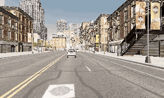](assets/videos/carla_town10hd_urban_clear_ep04.mp4) | [](assets/videos/carla_town10hd_urban_clear_ep09.mp4) |
| **Town10HD, urban, rain at sunset** | **Town04, highway, wet at sunset** |
| [](assets/videos/carla_town10hd_urban_rain_sunset_ep19.mp4) | [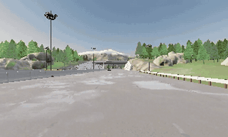](assets/videos/carla_town04_highway_wet_sunset_ep18.mp4) |

Video frames: CARLA simulator via mini-carla-192x320, CC BY 4.0.

## Scope

In scope:

- FEM mesh assembly, the SPDE precision Q(theta) and its sparse Cholesky factorisation, with a CPU reference and a CUDA path (cuSPARSE and cuDSS).
- The sparse projector P, with three barycentric weights per sensor.
- The ordering and fill-in result, reverse Cuthill-McKee against a scrambled node order.
- The int8 forward filter for Cortex-M, with a CMSIS-NN backend and a portable C99 reference, checked against a floating-point filter.

Out of scope:

- Not measured: GPU timings, cycles or latency per sample on a Cortex-M device, accuracy on recorded drives, and lane detection accuracy on the bundled clips. A MAC count is not a latency; no time figure SHALL be derived from the operation counts, and no latency claim SHALL be made, without a measurement on the target.
- Fitting the transition and emission parameters to recorded data, backward sampling, and the EM or Laplace update of the regime parameters described in case study 03.
- The CARLA simulation loop, R-CNN detection and the UART link to the microcontroller, which are a design only.

Assumptions: the observations are a lateral lane offset and an SDLP window, both in millimetres; the field enters the lateral offset channel only, through the lifted offset of the current site; the transition and emission parameters are illustrative; and all test data are simulated with fixed seeds.

Known limitations:

- The CUDA code in `gpu/` compiles with nvcc 12.9 against cuDSS 0.7.1.6 but not against cuDSS 1.0.0.35 (Figure 9). It has not been linked or run, and it MUST be checked against `gpu/compare.py` on a GPU before any GPU result is reported.
- The CMSIS-NN backend is bit-exact against the Python reference with CMSIS-NN v8.0.0 under QEMU (Figure 12). No release is pinned in this repository, and it has not run on a physical target.
- The Android application (the Java sources and `AndroidManifest.xml` at the repository root) is not built in CI and has not been run for this README.
- Reverse Cuthill-McKee on the 20 by 20 lattice gives 11,378 or 11,370 factor nonzeros depending on the input labelling: 500 and 500 of 1,000 seeds in the run that produced the committed figures, 502 and 498 in an earlier run. Seeds 0, 1 and 2, which the tests use, gave 11,378 in every run. The cause of the variation between runs has not been established.

## Architecture

<p align="center">
  <a href="docs/figures/spde-pipeline.png"></a>
  <br>
  <sub><b>Figure 1.</b> Heavy path and light path, as published in the case study. The mesh matrices C and G are assembled once. The GPU rebuilds Q(theta), factorises it and returns theta_hat and the field estimate x_hat. Those are lifted to the sensor locations and quantised for the device, which runs the forward filter on every sample. Re-estimation runs periodically, off the latency path. The figure names cuSOLVER for the factorisation; this repository uses cuDSS.</sub>
</p>

The expensive work, factorising a large sparse precision, depends only on how fast the environment changes, so it runs every few seconds or minutes on a GPU. The cheap work runs on every sample, and its cost is fixed by the number of regimes, not by the size of the field. Perception follows the same split: R-CNN detection is expensive, irregular in cost and tolerant of small delays, so the GPU processes it in near time while the regime filter runs at a fixed rate on the latest features. The decision runs on a bare-metal microcontroller rather than a general-purpose computer such as a Raspberry Pi, because it needs a deterministic, cycle-bounded loop that matches a 4 by 4 recursion on the class of device that ships, at lower power and cost; no edge computer is required, because the study asks a modelling question, not a deployment question.

## Repository layout

```
python/spdegmrf/   mesh, FEM assembly, SPDE precision, sparse Cholesky, projector,
                   estimation, lattice fill-in, float HMM filter, int8 quantisation, export
python/tests/      unit tests for every module above
python/tools/      fill-in figure script and operation-count table
gpu/               CUDA estimation with cuSPARSE and cuDSS, CMake, CPU comparison script
firmware/          C99 forward filter, portable int8 kernel, CMSIS-NN backend, host tests,
                   Cortex-M4F footprint script
assets/videos/     CARLA dashcam clips bundled with the application, with provenance
docs/videos/       GIF previews of the CARLA clips shown in this README
docs/figures/      case study pipeline figure (Figure 1)
docs/capture/      capture script and plotting script for the Figures section
docs/screenshots/  figures and logs written by the captures workflow
.github/workflows/ continuous integration
```

The Android project files at the repository root are retained from the original application.

## Requirements

- Python 3.11 with the packages in `python/requirements.txt`.
- A C99 compiler and make for the firmware host tests. CI uses gcc on Ubuntu.
- For the GPU path only: CUDA, cuSPARSE, cuDSS and CMake. These are not required for the tests.
- For a Cortex-M build only: the CMSIS-NN release the build pins, with `HMM_USE_CMSIS_NN` defined.
- For the captures only: Xvfb, xterm, xdotool, ImageMagick, arm-none-eabi-gcc with newlib, qemu-user, matplotlib, pyelftools and imageio-ffmpeg, as installed by [`.github/workflows/captures.yml`](.github/workflows/captures.yml).

## Build and Test

```
pip install -r python/requirements.txt
python -m pytest -s                  # Python reference and C kernel cross-check
make -C firmware test                # host build of the forward filter
python -m spdegmrf.export            # from python/: regenerate firmware headers
python python/tools/mac_table.py     # operation counts per stage, from the matrices
(cd firmware && python tools/footprint.py)   # Cortex-M4F footprint; needs pyelftools and CC_M4
```

On a machine with CUDA and cuDSS:

```
cmake -S gpu -B gpu/build && cmake --build gpu/build
(cd python && python -m spdegmrf.export --gpu-case ../case.bin)
./gpu/build/spde_gpu case.bin > gpu.csv && python gpu/compare.py gpu.csv
```

The CI workflow [`.github/workflows/ci.yml`](.github/workflows/ci.yml) runs the Python tests and the firmware host tests on Ubuntu on every push. The GPU build is excluded because hosted runners have no GPU.

### Test counts

| Check | Command | Result in the captures workflow |
|---|---|---|
| Python reference and C kernel cross-check | `CC=gcc python -m pytest -v -s` | 20 passed in 6.50 s, Python 3.11.18 (Figure 2) |
| Firmware host tests | `make -C firmware test CC=gcc WERROR=1` | 8 test functions, `firmware tests: all passed`, gcc 13.3.0 (Figure 10) |
| Firmware tests on Cortex-M4F, portable kernel | `qemu-arm -cpu cortex-m4` | `bit_exact_vs_python=yes`, all passed (Figure 12) |
| Firmware tests on Cortex-M4F, CMSIS-NN v8.0.0 kernel | `qemu-arm -cpu cortex-m4` | `bit_exact_vs_python=yes`, all passed (Figure 12) |
| Operation counts | `python python/tools/mac_table.py` | host stages per evaluation of theta and 40 MACs per sample on the device (Figure 3) |
| CUDA estimation | `nvcc -c gpu/src/spde_gpu.cu` | compiles with cuDSS 0.7.1.6; fails with cuDSS 1.0.0.35 (Figure 9) |

The firmware vector test covers 600 committed samples and reports an int8 against float mode agreement of 0.9933 on them; the 99.66% in Figure 8 is the Python test over 5,000 samples. Both runs report 0 floor hits.

## Figures

All figures except Figure 1, which is a case study figure, are generated by [`.github/workflows/captures.yml`](.github/workflows/captures.yml) on an `ubuntu-24.04` runner from the sources in this repository, using [`docs/capture/capture.sh`](docs/capture/capture.sh) and [`docs/capture/plots.py`](docs/capture/plots.py). Terminal figures are screenshots, taken with ImageMagick `import`, of xterm running the named commands on an Xvfb display; plots are written by matplotlib from arrays computed by `python/spdegmrf`; the frame grid is cut from the bundled clips with ffmpeg. No figure is drawn by hand or edited beyond cropping. The log of each run is kept next to its image in [`docs/screenshots/`](docs/screenshots/), and tool versions are in [`docs/screenshots/versions.log`](docs/screenshots/versions.log). Select any figure to open it at full resolution.

| Figure | Subject | Tool | Source |
|---|---|---|---|
| 1 | Heavy path and light path | Case study figure | `docs/figures/spde-pipeline.png` |
| 2 | pytest run | pytest 9.2.0, Python 3.11.18, gcc 13.3.0 | `python/tests/` |
| 3 | Operation counts | Python 3.11.18, NumPy 2.4.6, SciPy 1.17.1 | `python/tools/mac_table.py` |
| 4 | Simulated field, observations and posterior mean | matplotlib 3.11.2 | `python/spdegmrf/export.py`, `estimate.py` |
| 5 | Marginal log-likelihood over (kappa, tau) | matplotlib 3.11.2 | `python/spdegmrf/estimate.py` |
| 6 | Sparsity of Q and of its Cholesky factor | matplotlib 3.11.2 | `python/spdegmrf/lattice.py`, `cholesky.py` |
| 7 | Scrambled-order fill-in over 1,000 relabellings | matplotlib 3.11.2 | `python/spdegmrf/lattice.py`, `cholesky.py` |
| 8 | Float and int8 forward filters | matplotlib 3.11.2 | `python/spdegmrf/hmm.py`, `quant.py` |
| 9 | CUDA compile against two cuDSS releases | nvcc 12.9.86, cuDSS 0.7.1.6 and 1.0.0.35 | `gpu/src/spde_gpu.cu` |
| 10 | Firmware host tests | gcc 13.3.0, make | `firmware/tests/test_hmm_filter.c` |
| 11 | Cortex-M4F static footprint | arm-none-eabi-gcc 13.2.1, arm-none-eabi-size, pyelftools | `firmware/src/`, `firmware/tools/footprint.py` |
| 12 | Firmware tests on Cortex-M4F, portable and CMSIS-NN kernels | arm-none-eabi-gcc 13.2.1, qemu-arm 8.2.2, CMSIS-NN v8.0.0 | `firmware/tests/test_hmm_filter.c`, `firmware/src/hmm_fc_s8_cmsis.c` |
| 13 | CARLA still frames | ffmpeg (imageio-ffmpeg build), ImageMagick 6.9.12 | `assets/videos/*.mp4` |

### Python reference

<p align="center">
  <a href="docs/screenshots/terminal_pytest.png">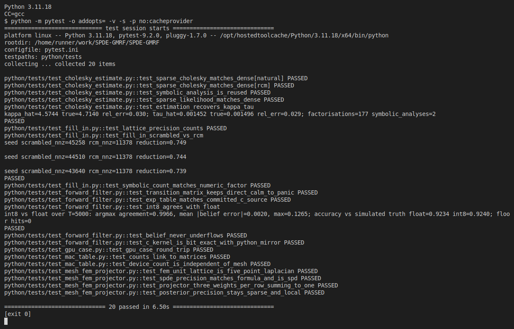</a>
  <br>
  <sub><b>Figure 2.</b> The 20 tests in <code>python/tests/</code>, run with <code>CC=gcc</code> so that the C kernel cross-check runs: all 20 pass in 6.50 s. The printed lines show the estimates of kappa and tau (relative errors 3.0% and 2.9%, 177 numeric factorisations after 2 symbolic analyses), the scrambled and RCM factor counts for seeds 0, 1 and 2, and the int8 against float agreement over 5,000 samples. Log: <a href="docs/screenshots/terminal_pytest.log">terminal_pytest.log</a>.</sub>
</p>

<p align="center">
  <a href="docs/screenshots/terminal_mac_table.png">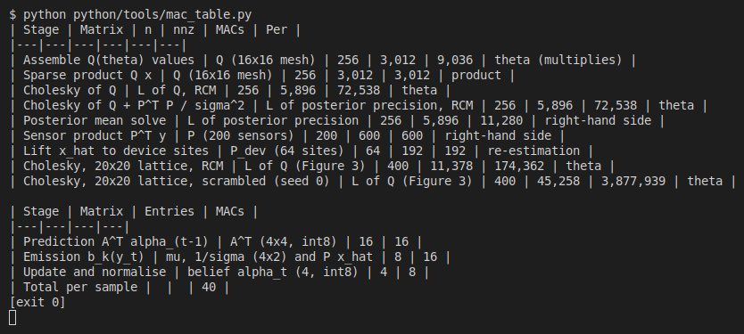</a>
  <br>
  <sub><b>Figure 3.</b> Operation counts per stage from <code>python/tools/mac_table.py</code>, computed from the sparsity pattern of each matrix: the host stages per evaluation of theta on the 16 by 16 estimation mesh and the 20 by 20 lattice, and the device stages per sample. Log: <a href="docs/screenshots/terminal_mac_table.log">terminal_mac_table.log</a>.</sub>
</p>

<p align="center">
  <a href="docs/screenshots/plot_field_estimate.png">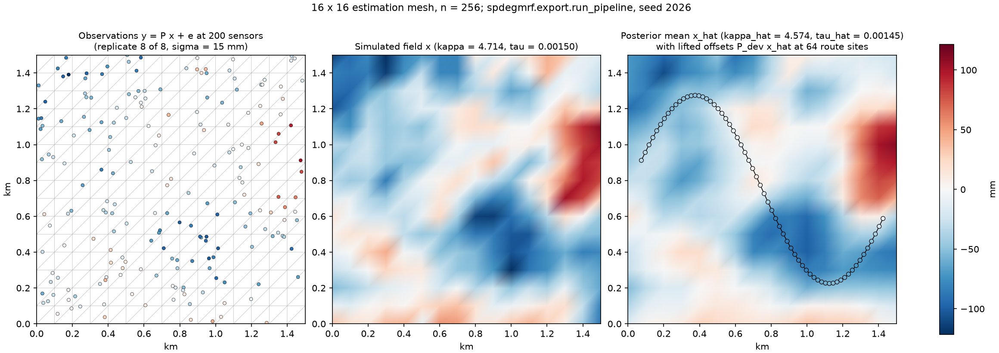</a>
  <br>
  <sub><b>Figure 4.</b> The pipeline of <code>spdegmrf.export.run_pipeline</code> (seed 2026) on the 16 by 16 mesh over 1.5 km, n = 256. Left: the 200 sensor observations of the eighth replicate over the mesh triangles. Centre: the simulated field, kappa = 4.714 and tau = 0.00150. Right: the posterior mean at the estimates kappa_hat = 4.574 and tau_hat = 0.00145, with the 64 route sites coloured on the same scale by their lifted offsets P_dev x_hat (from -88.6 to 9.6 mm), so that each site matches the field beneath it. The script checks that its estimate and offsets equal those of <code>run_pipeline</code>.</sub>
</p>

<p align="center">
  <a href="docs/screenshots/plot_loglik_surface.png">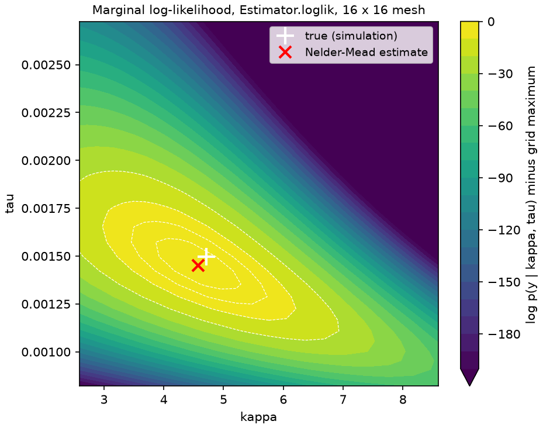</a>
  <br>
  <sub><b>Figure 5.</b> The marginal log-likelihood of <code>Estimator.loglik</code> on a 25 by 25 grid of (kappa, tau), relative to the grid maximum; white contours at -2, -5, -10 and -20. The 625 evaluations used 1,250 numeric factorisations and the 2 symbolic analyses made once. The cross marks the Nelder-Mead estimate and the plus sign the value used in the simulation.</sub>
</p>

<p align="center">
  <a href="docs/screenshots/plot_sparsity.png">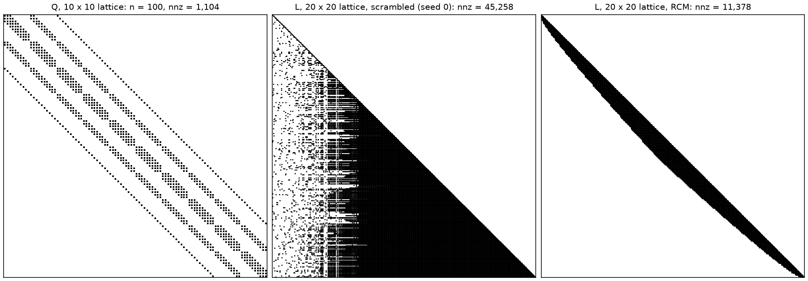</a>
  <br>
  <sub><b>Figure 6.</b> Left: Q on the 10 by 10 lattice, 1,104 nonzeros, at most 13 per row. Centre and right: the Cholesky factor of Q on the 20 by 20 lattice after the seed 0 relabelling, 45,258 nonzeros, and after reverse Cuthill-McKee, 11,378 nonzeros.</sub>
</p>

<p align="center">
  <a href="docs/screenshots/plot_fill_in_seeds.png">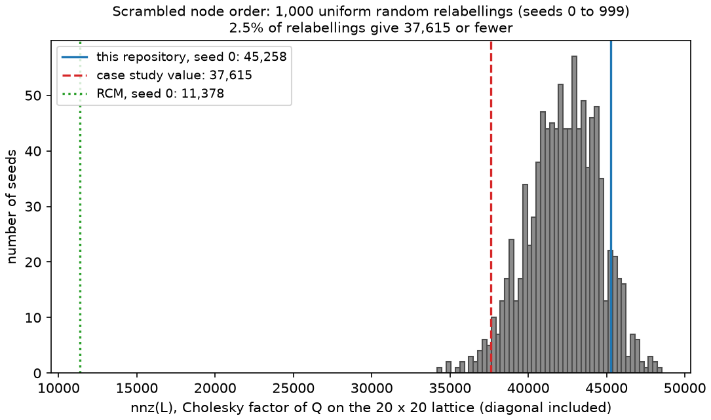</a>
  <br>
  <sub><b>Figure 7.</b> Factor nonzeros on the 20 by 20 lattice for 1,000 uniform random relabellings (seeds 0 to 999): minimum 34,195, median 42,308, maximum 48,532. The case study count of 37,615 lies at the 2.5th percentile; seed 0 of this repository gives 45,258. The RCM line is the seed 0 value; across the 1,000 seeds RCM gives 11,378 or 11,370 (see <a href="#scope">Scope</a>). Log: <a href="docs/screenshots/plots.log">plots.log</a>.</sub>
</p>

<p align="center">
  <a href="docs/screenshots/plot_forward_filter.png">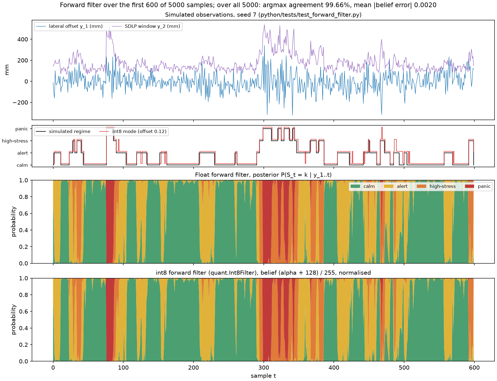</a>
  <br>
  <sub><b>Figure 8.</b> The data of <code>python/tests/test_forward_filter.py</code> (seed 7), first 600 of 5,000 samples. From the top: the two observation channels; the simulated regime and the int8 mode; the float forward filter posterior; and the int8 belief of <code>quant.Int8Filter</code>, dequantised as (alpha + 128) / 255 and normalised. Over all 5,000 samples the argmax agreement is 99.66% and the mean absolute belief error is 0.0020. All data are simulated.</sub>
</p>

### GPU estimation

<p align="center">
  <a href="docs/screenshots/terminal_nvcc.png"></a>
  <br>
  <sub><b>Figure 9.</b> nvcc 12.9.86 compiles <code>gpu/src/spde_gpu.cu</code> against the cuDSS 0.7.1.6 headers. Against cuDSS 1.0.0.35 it stops with eight errors at lines 179 and 181, where <code>cudssMatrixCreateCsr</code> now takes an <code>offsetType</code> argument. Compile only: the object is not linked or run, because the runner has no GPU. Log: <a href="docs/screenshots/terminal_nvcc.log">terminal_nvcc.log</a>.</sub>
</p>

### Firmware

<p align="center">
  <a href="docs/screenshots/terminal_fw_host.png"></a>
  <br>
  <sub><b>Figure 10.</b> <code>make -C firmware test CC=gcc WERROR=1</code> with gcc 13.3.0: the portable filter matches the Python integer mirror bit for bit over the 600 committed vectors, and all tests pass. Log: <a href="docs/screenshots/terminal_fw_host.log">terminal_fw_host.log</a>.</sub>
</p>

<p align="center">
  <a href="docs/screenshots/terminal_fw_m4_size.png"></a>
  <br>
  <sub><b>Figure 11.</b> Cortex-M4F build with arm-none-eabi-gcc 13.2.1 at <code>-Os</code>: section sizes of the filter, kernel, exp2 table and generated model (1,014 bytes of text, 788 of rodata, 16 of bss), stack frames from <code>-fstack-usage</code>, the call graph from <code>-fcallgraph-info</code>, the linked image with libgcc (<code>.text</code> 1,880 bytes, <code>__udivmoddi4</code> 700 bytes), and the same objects measured by <code>firmware/tools/footprint.py</code>. Log: <a href="docs/screenshots/terminal_fw_m4_size.log">terminal_fw_m4_size.log</a>.</sub>
</p>

<p align="center">
  <a href="docs/screenshots/terminal_fw_m4_qemu.png">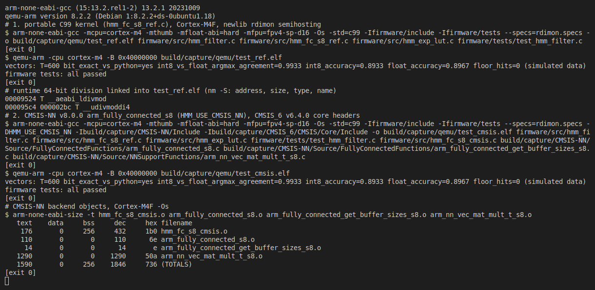</a>
  <br>
  <sub><b>Figure 12.</b> The firmware tests cross-compiled for Cortex-M4F with newlib semihosting and run under <code>qemu-arm -cpu cortex-m4</code>: first with the portable kernel, then with CMSIS-NN v8.0.0 <code>arm_fully_connected_s8</code>. Both are bit-exact with the Python mirror and pass. QEMU gives no cycle counts. Log: <a href="docs/screenshots/terminal_fw_m4_qemu.log">terminal_fw_m4_qemu.log</a>.</sub>
</p>

### CARLA clips

<p align="center">
  <a href="docs/screenshots/carla_frame_grid.png">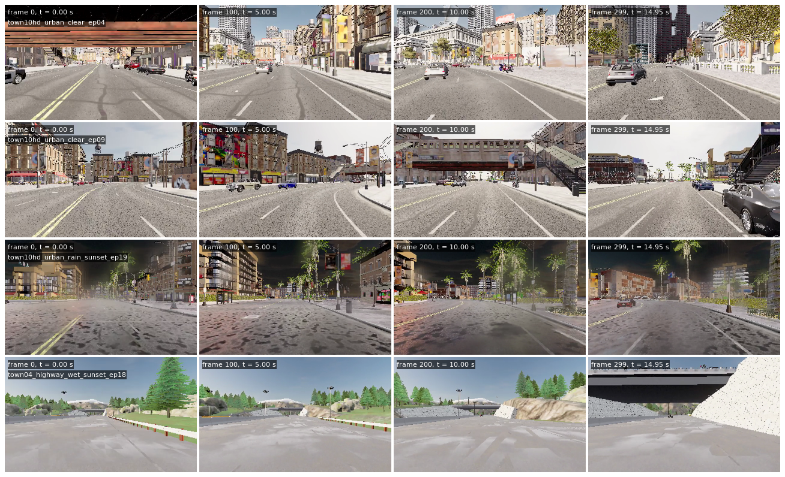</a>
  <br>
  <sub><b>Figure 13.</b> Frames 0, 100, 200 and 299 (t = 0, 5, 10 and 14.95 s) of each bundled clip, scaled to the 320 by 192 capture resolution: Town10HD urban in clear weather (episodes 4 and 9), Town10HD urban in rain at sunset (episode 19) and Town04 highway on a wet road at sunset (episode 18). Video frames: CARLA simulator via mini-carla-192x320, CC BY 4.0. Stream details: <a href="docs/screenshots/carla_frame_grid.log">carla_frame_grid.log</a>.</sub>
</p>

## Security

Commits SHALL be signed with the maintainer key in [KEYS.asc](KEYS.asc). Verification steps and vulnerability reporting are in [SECURITY.md](SECURITY.md).

## Attribution

- Original application and project report, *Computer Vision on Nomadic Devices for Human Factors Engineering*, by Wahib-ul-Haq (TUM): [project report](https://www.academia.edu/11329425/Computer_vision_on_nomadic_devices_for_human_factors_engineering).
- Core lane detection based on [lane-detection](https://github.com/jdorweiler/lane-detection) by J. Dorweiler, described in [Revisiting lane detection using OpenCV](http://www.transistor.io/revisiting-lane-detection-using-opencv.html), ported to the Android NDK and optimised for smartphones in the original application.
- Related case study: [Lifting SPDE-GMRF Fields: GPU Estimation and On-Device Forward Filtering](https://whatheheckisthis.github.io/case-studies/spde-gmrf-gpu-edge/).
- Journal entry: [Hidden States: Modelling Driver Behaviour with CARLA, CUDA and a Microcontroller in the Loop](https://whatheheckisthis.github.io/blog/hidden-states-behavioural-time-series/).
- [CARLA simulator](https://carla.org/). Bundled driving videos: [mini-carla-192x320](https://huggingface.co/datasets/kamwoh/mini-carla-192x320) by kamwoh, CC BY 4.0.
- Previous case study: [Hidden Markov models with Gaussian fields](https://whatheheckisthis.github.io/case-studies/hmm-gaussian-fields/), [Hidden Markov model overview](https://en.wikipedia.org/wiki/Hidden_Markov_model).
- Lindgren, Rue and Lindstrom, [An explicit link between Gaussian fields and Gaussian Markov random fields: the SPDE approach](https://doi.org/10.1111/j.1467-9868.2011.00777.x).
- NVIDIA [cuSPARSE](https://docs.nvidia.com/cuda/cusparse/), [cuDSS](https://docs.nvidia.com/cuda/cudss/) and [cuSOLVER](https://docs.nvidia.com/cuda/cusolver/) documentation; Arm [CMSIS-NN](https://github.com/ARM-software/CMSIS-NN).

## Licence

MIT. The original copyright notice (Copyright (c) 2014 wahib-ul-haq) is retained in [LICENSE](LICENSE). The CARLA videos in `assets/videos/` are CC BY 4.0.
